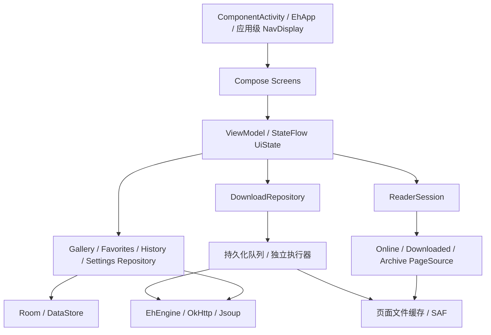

# Compose / Kotlin 重构方案

日期：2026-10-30。范围：基于当前工作区的源码评估；本轮只新增方案文档，没有修改应用代码或执行构建。

补充范围：用户已明确“先实现 Compose，不考虑支持 iOS”。当前交付优先 Android Compose；为以后 Android + Desktop/JVM 的 KMP/CMP 复用保留边界，不在本轮建立 iOS source set 或实现。

## 1. 结论与边界

建议采用「保留站点协议和数据兼容性，重做应用壳、阅读器及状态管理」的路线。目标是 Kotlin 编写应用逻辑、Compose 编写界面，删除项目的 NDK/CMake/JNI 和自研 GL 阅读框架。

本方案把“去原生层”定义为：应用不再维护 C/C++、NDK/CMake 和自定义 JNI，也不以预编译 libarchive AAR 代替原有原生压缩层。可以调用 Android 框架的图片解码、Canvas、SQLite 和 JDK API；成熟的纯 JVM Java 库可以由 Kotlin 调用。上一版把这个目标扩大成“所有平台、所有依赖都不能含原生二进制”过于严格：未来桌面 CMP 使用的 Skia/Skiko 等官方渲染运行时应按平台正常打包，不在删除范围内。

旧的 `tech-stack-upgrade-report.md` 保留作历史记录。其“预编译 libarchive AAR”路线只解决本机不装 NDK，仍携带原生库，不作为本次目标方案。旧报告中的工作量、构建结果不能作为本方案的验证结果。

## 2. 当前代码的实际状态

| 范围 | 源码事实 | 重构影响 |
|---|---|---|
| 工程 | 单一 `:app`，244 个 Kotlin 文件、108 个 Java 文件；`minSdk=31`、`targetSdk=36` | 已有 Kotlin 基础，无须创建另一套应用重写协议 |
| Compose | 已接入 Compose、Material 3 Expressive 和 Navigation 3；站点选择、进度、画廊信息、预览图、评论、登录、Cookie 登录、手势锁、历史、收藏、画廊列表、下载、详情、阅读器、Web 登录十五个 Scene 全部是 `EhComposeScene`，**XML Scene 已清零** | 依赖可复用，尚未形成应用级导航宿主 |
| 导航 | `MainActivity` 继承 `StageActivity`；`EhComposeScene` 继承 `SolidScene`，每个实例内又创建 `NavDisplay` | 这是迁移桥，最终需收敛到应用级导航宿主 |
| 大页面 | 已全部拆分：详情 1053 + 925，列表 770 + 1013，收藏 579 + 598，下载 482 + 1042（前者 Scene 管状态与请求，后者 Screen 是纯 UI）；四页共用 `component/GalleryItems.kt`（399 行）与 `component/SearchPanel.kt`（518 行） | 先抽业务与状态，再替换界面，避免把大 Scene 原样搬进 Composable |
| 阅读器 | `GalleryActivity` 1305 行；`glview`/`glgallery` 共 49 个文件 | 阅读器需要单独重做，不能只替换 XML |
| 图片管线 | `SpiderQueen` 下载后直接 `Image.decode()`；`GalleryProvider` 用 GL idle 回调分发已解码图片 | 下载、图片解码、渲染相互耦合，是首要拆分点 |
| 网络 | `EhEngine` 已有类型化的 `suspend` 方法；外层 `EhClient` 仍用整数方法码、`Any?` 参数与 callback | 可直接复用 Engine 和解析器，逐步删除请求分发表 |
| 数据 | 已用 Room；主库版本 4，`exportSchema=false`，`allowMainThreadQueries()`；DAO 多为同步方法 | 先补 schema 基线，再迁移 `suspend`/`Flow`，最后移除主线程查询 |
| 设置 | 839 行全局 `Settings`，基于 SharedPreferences | 先提供可观察接口，再做 DataStore 迁移 |
| 后台下载 | `DownloadManager` 1235 行，全局可变队列、listener、Handler；已有 `dataSync` 前台服务 | 需要独立于界面生命周期的队列与执行器 |
| 构建发布 | CMake 拉取 libarchive、xz、nettle；Gradle 和 CI 都按 ABI 拆包、上传原生符号 | 源码替换后还要同步清理 Gradle、Manifest 和两个发布 workflow |
| 测试 | 当前没有 `src/test`、`src/androidTest` 目录 | 先建立关键协议、档案和数据迁移样本，不能仅以编译通过验收 |

以上计数不包含构建产物。工作区已有未提交的 Compose 和依赖改动，本方案在此基础上评估。

### 2.1 收藏页结构决策（已落地，供后续列表页参照）

收藏页是第一个「带分类抽屉 + 分页 + 多选 + 修改收藏」的完整列表页，可作为列表/下载页迁移的参照样板。

- **抽屉归属**：分类列表放进场景内的 `ModalNavigationDrawer`，并设 `gesturesEnabled = false`，只由顶栏「收藏夹」图标打开。左侧边缘手势仍归属宿主 `DrawerLayout` 的 START 抽屉，避免两个左侧抽屉抢同一手势；宿主 END 抽屉不再为收藏页提供内容（`FavoritesScene` 不再覆写 `onCreateDrawerView`），左侧导航抽屉照旧由顶栏菜单图标 `toggleDrawer(START)` 打开。
- **顶栏三态**：标题态（标题 + 搜索/收藏夹/溢出菜单）、搜索态（自动聚焦 + `Search` IME 动作）、多选态（关闭 + 已选数 + 全选/下载/删除/移动）。
- **操作入口收敛**：原 8 个 FAB 折叠成「刷新 FAB + 溢出菜单（跳到日期 / 末页，仅云分类可见）」，旧的 FAB 折叠动效不再保留。
- **分页显式化**：`next` 承接服务端游标，`prev=1-0` 表示末页，`seek` 传日期字符串，与旧 `GalleryInfoContentHelper.goTo(Long, Boolean)` 语义一致；本地分类直接查 `EhDB`。日期选择用 `MaterialDatePicker`（DialogFragment）挂在 `supportFragmentManager`，区间约束保持 2007-03-21 ~ 昨天。
- **修改收藏沿用旧机制**：先置 `enableModify`，下一次加载先发 `MODIFY_FAVORITES` / `ADD_FAVORITES_RANGE`，应答同时充当列表刷新，再由 `updateHistoryFavSlot` 同步历史记录里的收藏槽位。这样删除/移动/加入云端仍是一次网络往返。
- 返回键顺序：取消多选 → 退出搜索 → 关闭页面；`getNavCheckedItem()` 仍是 `nav_favourite`。
- **已知取舍**：列表固定单列卡片，未接 `Settings.listMode` 网格模式；需要在 `GalleryListScene` 迁移、抽出统一列表组件时一起处理，否则会出现两套列表布局逻辑。（已于 2.2 一并解决。）

### 2.2 画廊列表页结构决策（已落地，列表/下载页的最后一块样板）

列表页是首页、订阅、热门、榜单、任意搜索结果的共同宿主，也是唯一同时具备「搜索面板 + 分页游标 + 项目上下文菜单 + 抽屉」的页面，因此它的结构决定了后续详情/下载页的写法。

- **共享条目组件**：新增 `ui/compose/component/GalleryItems.kt`，从旧 `item_gallery_list.xml` / `item_gallery_grid.xml` + `GalleryAdapter` 提炼出 `GalleryItem(info, layout, …)`。收藏页与列表页共用同一份卡片，`Settings.listMode`（`GalleryItemLayout.LIST/GRID`）是唯一开关，收藏页因此顺带补上了网格模式。
- **共享搜索面板**：新增 `ui/compose/component/SearchPanel.kt`，替代旧 `SearchLayout` + `search_*.xml`：分类从 `CheckTextView` 表改成 `FlowRow` chip（选中=包含，长按=其余取反）、搜索模式改成单选行、进阶条件（`SH/STO/SFL/SFU/SFT`、最低星级、页数区间）保留原校验文案；图片搜索页签保留「选图 → 计算 SHA-1 → `f_shash`」链路。条件装配集中在 `SearchPanelState.buildCriteria()`，纯逻辑并有单测覆盖。
- **顶栏三态**：标题态（点标题进简单搜索 + 菜单/搜索/抽屉/溢出）、简单搜索态、展开搜索态（正文换成搜索面板）。简单搜索沿用旧规则：`reset()` 后只保留「订阅搜索」模式。
- **抽屉**：右侧「快速搜索 / 榜单时间范围」抽屉搬进场景内的 `ModalNavigationDrawer`，用外层 `LayoutDirection.Rtl` 镜像到右侧、`gesturesEnabled = false` 只由顶栏打开；左侧导航抽屉仍归宿主。快速搜索支持选、删、拖拽排序（固定 56dp 行高估算目标下标，拖拽结束一次性写库）。
- **FAB 收敛**：4 个 mini FAB + primary 折叠动效改成「刷新 FAB + 溢出菜单（跳到日期 / 按 gid 跳 / 末页 / 榜单页码 / 列表-网格切换 / 添加快速搜索）」；长按条目是上下文对话框（阅读 / 下载或删除下载 / 收藏或取消收藏 / 移动下载标签），与旧行为一致（本页旧实现同样没有多选）。
- **分页承载**：非榜单用 `prev`/`next` 游标（`nextIndex` 承接 `result.next`），榜单用页码（`seek`/`p=`，`result.pages` / `result.nextPage`）；收藏槽位与下载角标不再重建列表，而是就地改 `GalleryInfo` 并自增快照版本号。
- **已知取舍**：① 搜索栏「粘贴画廊/分页 URL 的跳转建议」已在 2.7 补回；② 缩略图 → 详情页的共享元素转场降级为普通 Scene 转场；③ `WindowInsetsAnimationCompat` 的 FAB 与 IME 同步位移、`SearchBarMover` 的滚动隐藏搜索栏、`FabLayout` 折叠动效不再保留；④ 未迁移接收外部分享图片（`onReceiveContent`）的入口；⑤ 旧 `SearchBar`/`SearchLayout`/`CategoryTable`/`ImageSearchLayout` 类与其 `search_*.xml` 已在 2.5 整体删除。
- **验证**：`compileDebugKotlin`、`spotlessCheck`、`testDebugUnitTest`（新增 `SearchPanelStateTest`）、`assembleDebug` 全绿；已验证 `scene_gallery_list.xml`、`menu/drawer_gallery_list.xml`、`menu/quicksearch_option.xml` 无引用并删除。

### 2.3 下载页结构决策（已落地）

下载页没有网络请求，全部状态来自 `DownloadManager` 的内存表，所以迁移重点是「可变对象 → 不可变快照」和「操作台从 FAB 搬到顶栏」。

- **数据快照**：`DownloadsScene` 每次收到 `DownloadInfoListener` 回调或用户操作后重建 `infos: List<DownloadInfo>`（过滤 + 排序），再由 `uiState()` 映射成 `DownloadItemUi`（state/finished/total/speed/legacy 全部按值拷贝）。旧实现直接改 `RecyclerView` 的 `notifyItemChanged`，Compose 侧若不这样做会读到可变对象旧字段而不刷新。
- **派生顺序与旧实现一致**：先按 label 取列表（`allDownloadInfoList` / `defaultDownloadInfoList` / `getLabelDownloadInfoList`），再用 `mType` 槽位过滤（`-1` 全部、`0..4` 状态、`5` 标题关键字，保留旧实现关键字与状态共用槽位的 or 语义），最后按 11 种排序比较器排（`0..9` 见 `R.array.download_sort`，`10` 随机）。
- **抽屉**：右侧「下载标签」抽屉搬进场景内的 `ModalNavigationDrawer`（RTL 镜像、`gesturesEnabled = false`）；条目显示 `标签 [数量]`，前两项（全部 / 默认）不可拖动，真实标签可长按拖拽排序（`DownloadManager.moveLabel(from-2, to-2)`），长按弹出重命名 / 删除，顶栏两个图标负责「新建标签」「默认标签」。
- **操作台**：7 个 FAB（全选 / 置顶 / 开始 / 停止 / 删除 / 移动 + 关闭）改成「多选顶栏 = 关闭 + 已选数量 + 全选 + 溢出菜单」；删除带「同时删除图片文件」勾选（`Settings.putRemoveImageFiles`，勾选后写 `SpiderDen.getGalleryDownloadDir` + `removeDownloadDirname` 再异步删文件），移动列出「默认 + 全部标签」。
- **顶部菜单**：过滤（状态单选 + 标题关键字）/ 全部开始 / 全部停止 / 溢出（排序、反向全部开始、重置阅读进度、打开标签抽屉）；旧实现「改排序即写回 `Settings.putDefaultSortingMethod`」的行为保留。
- **列表布局**：`AutoStaggeredGridLayoutManager(Settings.detailSize)` 换成 `LazyVerticalGrid(GridCells.Adaptive(132.dp))`，`key = gid`；`KEY_GID` 进入时在 `LaunchedEffect` 里 `scrollToItem`（替代旧的 `mInitPosition` 延迟滚动）。
- **已知取舍**：① 去掉 `FastScroller` 与主列表的手动拖动置顶（顺序改由排序菜单与「置顶」多选操作控制）；② 卡片是统一高度（封面 2:3 + 标题 + 一行状态/进度），旧实现的 `SimpleItemAnimator.supportsChangeAnimations=false` 对应的「不发生形变」效果自然成立；③ 缩略图点击进详情保留，但共享元素转场降级为普通 Scene 转场（与列表页同一取舍）；④ 移除了旧的 `move` 拖拽手柄，`state == DOWNLOAD` 时不再隐藏上传者/分类（改为固定占位，避免卡片高度跳变）。
- **验证**：`compileDebugKotlin`、`spotlessCheck`、`testDebugUnitTest`、`assembleDebug` 全绿；`scene_download.xml`、`item_download.xml`、`menu/scene_download.xml`、`menu/drawer_download.xml`、`menu/download_label_option.xml`、`layout/drawer_list_rv.xml`、`layout/item_drawer_list.xml` 已确认无引用并删除。

### 2.4 详情页结构决策（已落地）

详情页是唯一带「标签 + 评分 + 归档/种子 + 评论/预览联动 + 共享元素转场」的页面，也是最后一块。它的状态比列表页更碎，但本质仍是「一次请求 + 一堆派生视图」。

- **状态机**：旧 `ViewTransition` 的五态收敛成 `DetailPhase`（`INIT` / `REFRESH` / `REFRESH_HEADER` / `NORMAL` / `FAILED`）单值状态；`REFRESH_HEADER` 表示「头部已缓存、正文在重载」，由 Compose 侧渲染成「头部 + 局部 loading」。缓存仍走 `galleryDetailCache` + `application.putGlobalStuff()` 防重复请求。
- **快照**：`uiState()` 每次从 `GalleryDetail` 派生 `TagGroupUi` / `CommentUi` / `PreviewUi`；`downloadState`、`startPage`、`localFavorites` 是 Compose 状态字段，`version` 负责在就地改 `GalleryDetail` 字段（收藏、评分、投票）后触发重组。**`EhDB.containLocalFavorites()` 这类 DB 查询放在 `onResume` 里做，不进 `uiState()`**，否则每次重组都会查一次库。
- **头部**：`back_action` / `other_actions` 换成 `TopAppBar` 的返回与溢出菜单（刷新 / 添加标签 / 清除图片缓存 / 用其他应用打开），标题 + 上传者 + 分类放在渐变信息区，上传者与分类仍可点（筛选）与长按（加过滤）。
- **信息与操作**：信息行（语言 / 页数 / 收藏数 / 发布时间 / 大小）与「更多信息」仍进 `GalleryInfoScene`；下载按钮按 `DownloadState` + `hasNewerVersions` 显示 `download` / `download_upgradeable` / 各状态文案，长按强制下载到默认目录；收藏点击走 `CommonOperations.addToFavorites/removeFromFavorites`（长按 = 快速选择槽位），角标状态由 `localFavorites` + `isFavorited` 决定；分享 / 种子数 / 归档 / 相似画廊一行排开。
- **标签**：`AutoWrapLayout` 换成 `FlowRow` chip，`_W`（弱化）、`_L`（锁定/斜体）、`_U`/`_D`（已投票）语义保留，翻译仍走 `EhTagDatabase`（`Settings.showTagTranslations` 开关不变）；点击按 tag 搜索，长按菜单保留复制 / 查看定义 / 加入过滤 / 上投票 / 下投票（未登录时隐藏投票项）。
- **评论 / 预览**：评论预览取前 2 条，正文仍用 `Html.fromHtml` 生成 `Spanned`，再在组合期用主题链接色转成 `AnnotatedString`；点评论进 `GalleryCommentsScene`（仍带 `setRequestCode`，返回时用 `KEY_COMMENT_LIST` 回填）。预览图用 `PreviewSet.getGalleryPreview(gid, i)` 的 `imageKey` / `imageUrl` 走 coil，列宽跟随 `Settings.previewSize`，点击直接进 `GalleryActivity` 对应页。
- **归档 / 种子 / 评分**：三个对话框保留原 XML（`dialog_archive_list` / `dialog_torrent_list` / `dialog_rate` + `GalleryRatingBar`），逻辑从旧 helper 原样搬进 Scene：归档列表带资金显示与 `METHOD_DOWNLOAD_ARCHIVE`，种子列表用系统 `DownloadManager` 并带上 Cookie，评分用 `METHOD_GET_RATE_GALLERY` 并就地更新 `rating` / `ratingCount`。
- **已知取舍**：① 列表/下载 → 详情的**共享元素转场彻底取消**（`EnterGalleryDetailTransaction` 已删除；Compose 场景无法在 `onCreateView` 之后再建 `ViewTransition`）；② 头部 `CircularReveal` 渐入动画不再保留；③ 「已下载但有新版本」不再弹升级重下对话，改为普通的删除/重新下载入口（`download_upgradeable` 文案仍在）；④ 评论正文里的图片（`URLImageGetter`）不再加载，纯文本与链接保留；⑤ `onReceiveContent` 的外部分享图片入口未迁移；⑥ 未保留 `ViewTransition` 的下拉刷新手势，刷新走溢出菜单。
- **验证**：`compileDebugKotlin`、`spotlessCheck`、`testDebugUnitTest`、`assembleDebug` 全绿；`scene_gallery_detail.xml`、`gallery_detail_{header,content,actions,tags,comments,previews,info}.xml`、`menu/scene_gallery_detail.xml` 与 `EnterGalleryDetailTransaction.kt` 已确认无引用并删除。

### 2.5 旧 XML 控件栈退役（清理片）

14 个页面全部迁完后再扫一遍「谁还在引用旧控件」，把已经悬空的一整条栈删掉，避免下一个人误以为还有两套实现。

- **删除的类**：`widget/SearchBar.kt`、`widget/SearchLayout.kt`、`widget/CategoryTable.kt`、`widget/ImageSearchLayout.kt`、`widget/FabLayout.kt`、`widget/SearchBarMover.java`、`view/BringOutTransition.java`。这些类的剩余引用只有彼此之间的互引与注释，宿主已全部是 Compose。
- **删除的布局**：`search_action.xml`、`search_advance.xml`、`search_category.xml`、`search_image.xml`、`search_normal.xml`、`widget_category_table.xml`、`widget_image_search.xml`、`widget_search_bar.xml`、`item_simple_list_2.xml`（搜索建议列表，随 `SearchBar` 一起退役）。
- **顺带清掉的孤儿布局**（按「全仓代码 + XML 交叉引用」扫出来、零引用的）：`dialog_recycler_view.xml`、`gallery_tag_group.xml`、`item_gallery_tag.xml`、`item_gallery_comment.xml`、`item_gallery_preview.xml`、`item_hosts.xml`、`preference_recyclerview.xml`。
- **刻意保留**：`widget/AdvanceSearchTable.kt`（`SH`/`STO`/`SFL`/`SFU`/`SFT` 位常量仍被 `SearchPanel`、`ListUrlBuilder`、`EhEngine` 引用）、`easyrecyclerview/FastScroller.kt`（仍被 `ContentLayout` 使用）、`GalleryAdapter` + `item_gallery_list.xml`/`item_gallery_grid.xml`（`GalleryActivity` 阅读器还在用）、`dialog_rate.xml`/`dialog_archive_list.xml`/`dialog_torrent_list.xml`/`item_select_dialog.xml`（详情页三个对话框）。
- **验证**：删除后 `compileDebugKotlin`、`spotlessCheck`、`testDebugUnitTest`、`assembleDebug` 全绿；孤儿扫描脚本（代码 `R.layout.x` / `@layout/x` 双向匹配）复扫结果为 0。

### 2.6 Web 登录页迁移（XML Scene 清零）

`WebViewSignInScene` 是最后一个 `SolidScene`。它本来就没有 XML 布局（WebView 是代码构造的），所以迁移只是把它接进 Compose 树，逻辑一行没改：

- `WebViewSignInScene : EhComposeScene()`，`startRoute = EhRoute.WebViewSignIn`，`needShowLeftDrawer() = false` 保留（登录页不该有导航抽屉）。
- 新增 `ui/compose/screen/SignInWebViewScreen.kt`：`AndroidView(factory = { createWebView() })` + 顶部 `LinearProgressIndicator`（`onProgressChanged` 上报，1..99 时才显示），WebView 背景改透明跟随 Compose 主题（旧实现固定取 `android.R.attr.colorBackground`）。
- 行为保持不变：进入时 `CookieManager.flush/removeAllCookies/removeSessionCookies` + `EhCookieStore.loadForWebView(URL_SIGN_IN, cloudflare)`；`onPageFinished` 里抓到 `ipb_member_id` + `ipb_pass_hash` 就 `signOut()` 后写入 `DOMAIN_EX` / `DOMAIN_E` 的持久 Cookie，然后 `setResult(RESULT_OK)` + `finish()`；Cloudflare Cookie 单独落库。`onDestroyView` 里 `destroy()` WebView。
- `activity_webview.xml` 保留：`MyTagsFragment` / `UConfigFragment` 仍在 inflate 它。
- **验证**：`compileDebugKotlin`、`spotlessCheck`、`testDebugUnitTest`、`assembleDebug` 全绿；`ui/scene` 下已无 `SolidScene`/`BaseScene` 子类（15 个 Scene 全部 Compose）。

### 2.7 粘贴链接的跳转建议（补回 2.2 的取舍 ①）

列表页顶栏改 Compose 时丢掉了旧 `SearchBar.SuggestionProvider` 的能力：搜索框内容若是画廊链接，会多出一行「打开画廊」。现在补回来了，并且顺手把它抽成了可测的纯函数。

- **纯函数**：`ui/compose/screen/UrlSuggestionUi.kt` 里是模型 `UrlSuggestionUi`（`Detail(gid, token)` / `Page(gid, pToken, page)`）与 `parseUrlSuggestion(text)`，解析顺序与旧实现一致：先 `GalleryDetailUrlParser`，再 `GalleryPageUrlParser`，都不匹配返回 null（此时按普通关键字搜索）。
- **状态管线**：`parseUrlSuggestion` 只在 `uiState()` 里调用一次，结果作为 `suggestion` 进快照；UI 只在搜索态（简单搜索 / 展开搜索）且 `suggestion != null` 时，在顶栏下方渲染一行 `UrlSuggestionRow`（书本图标 + `gallery_list_search_bar_open_gallery`），点击后由 Scene 决定去向：
  - `Detail` → `GalleryDetailScene` 的 `ACTION_GID_TOKEN`；
  - `Page` → `ProgressScene` 的 `ACTION_GALLERY_TOKEN`（带 `pToken` 与 `page`）；
  - 两种情况都会把顶栏切回标题态，与旧实现「点建议即退出搜索」一致。
- **测试**：新增 `GalleryUrlSuggestionTest`（详情链接 / 分页链接 / 普通关键字 / 空白 / 详情优先 五组用例）。旧实现写在 `SearchBar.SuggestionProvider` 里无法单测，这也是这次把它抽成顶层函数的主要理由。
- **验证**：`compileDebugKotlin`、`spotlessCheck`、`testDebugUnitTest`、`assembleDebug` 全绿。

### 2.8 阅读器换栈后的二次孤儿扫描（P7 第一批）

阅读器 R1–R8 删掉 GL 栈后，`com/hippo/widget` 与 `com/hippo/yorozuya` 里一批自研类失去了最后一个调用者。按「全仓代码 + res XML 双向匹配」复扫，删掉 10 个零引用类：

- `widget/`：`ColorView`、`LinkifyTextView`、`RadioGridGroup`、`SimpleGridAutoSpanLayout`、`SimpleGridLayout`、`TextClock`
- `yorozuya/`：`ResourcesUtils`、`thread/{InfiniteThreadExecutor, PriorityThreadFactory, PriorityThread}`

两条容易误判的点，记下来给下一批扫：

1. **布局里用的是全限定名**（`<com.hippo.widget.CuteSpinner`），按简单名匹配会把它们误判成孤儿。第一次扫描就是这样把 `CuteSpinner` /
   `IgnoreFitsSystemWindowsFullyDraggableDrawerContentLayout` / `IndicatingListView` 误报了，二次复核才捞回来——它们都还活着。
2. **孤儿会级联**：`SimpleGridLayout` 与 `PriorityThread` 自己不是零引用，唯一的引用者是被删掉的子类 / 工厂，删完才变成孤儿。所以扫一遍不够，删完必须再扫一遍。

`SimpleGridLayout` 的 `declare-styleable`（`columnCount` / `itemMargin`，别处无引用）一并从 `attrs.xml` 移除。

**验证**：四道门禁全绿；`com/hippo/yorozuya/thread/` 已清空。

#### 第二批

删完立刻再扫一遍，又掉下来 7 个：

- `ehviewer/widget/`：`ReversibleSeekBar`、`SearchEditText`、`SimpleRatingView`、`TileThumb`、`FixedThumb`
- `ehviewer/`：`WindowInsetsAnimationHelper`
- `widget/`：`DateUtils`

`FixedThumb` 的 `declare-styleable`（`minAspect` / `maxAspect` / `alwaysCutAndScale`）一并移除。

**误报要人工复核**：`DownloadInfoMagics` 被 `DownloadThumbInterceptor.kt` 以
`import ...DownloadInfoMagics.decodeMagicRequestOrUrl` 的方式引用，按简单名扫描会漏掉
这种「只有 import 行带全限定名」的用法。`FixedThumb` 反过来——它唯一的「引用」是
`GalleryPreviewsScreen` 里一句历史注释，脚本判成活着，实际是死的。所以脚本只能给候选，
删之前必须逐个 `git grep` 复核。

顺带扫了孤儿资源：**23 个 layout、drawable 下的 XML 全部有引用**，资源侧这轮没有孤儿。

**验证**：四道门禁全绿（63 例不变，这两批只删不改逻辑）。

#### 第三批：资源侧

代码侧扫完再扫资源，两个方向都做了：

- **layout / drawable**：23 个 layout、drawable 下全部 XML 都有引用（`R.layout.x` / `@layout/x` /
  Manifest 三路交叉匹配），这轮没有孤儿。
- **字符串**：`values/strings.xml` 590 条里查出 5 条零引用，5 份语言文件一起删：
  `passwd_cannot_be_empty`、`passwd_wrong`（压缩包密码框重做后不再提示）、
  `gallery_menu_title`（`GalleryMenuHelper` 随旧阅读器删了）、
  `start_download_original`、`error_empty`。删完复扫 **0 孤儿 / 585 条**。
- **array / plurals**：无孤儿。

判定口径：引用只看 `R.string.x` 与 `@string/x` 两种写法，**翻译文件里的同名定义不算引用**
——否则每条都会被自己所在的 5 个语言文件判成「有人用」。

**顺带确认**：`com/hippo/scene/` 与 `ui/scene/` 下的 `Announcer` / `SceneFragment` /
`SceneHost` / `TransitionHelper` / `BaseScene` / `SolidScene` / `ToolbarScene` /
`EhCallback` / `TransitionNameFactory` / `ReaderScene` / `GalleryAdapter` / `GalleryHolder`
在 P7-e 就已经删过了（工作区里是待提交的删除），现在磁盘上只剩空目录。它们剩下的「引用」
全是别处注释里的历史名词。

## 3. 四组 JNI 的替代

### 3.1 SHA-1：直接改成 Kotlin 调用 MessageDigest

入口在 `unifile/UniFileExtensions.kt`，当前新开 fd 后调用 `jni.sha1(fd)`。改为 `openInputStream().use`，分块更新 `MessageDigest("SHA-1")`，输出相同的小写十六进制。

保持协议要求的 SHA-1：图片搜索和远端文件校验不能擅自换算法。统一在 IO dispatcher 执行，保留流关闭语义，读失败应抛错而不是返回部分摘要。

### 3.2 GIF：优先删除补丁，使用 Coil 已有实现

当前 `EhApplication` 注册的是 `AnimatedImageDecoder.Factory(false)`，关闭了 Coil 的最小帧延迟处理，然后 `image/Image.kt` 在 Android 12/13 上通过 JNI 检测、mmap 和修补 GIF。

核实项目正在使用的 **Coil 3.5.0 源码**：`AnimatedImageDecoder.Factory` 的默认参数在 API 34 以下开启修补，`FrameDelayRewritingSource` 已实现同类逻辑。因此第一选择是恢复默认配置，并删除应用层补丁；保留修补前后的动图样本验证播放和源文件不变，再决定是否需要兼容层。

旧 C 逻辑遇到正常延迟会提前结束扫描，Coil 的实现不必与它逐字节一致，应以播放行为验收。GIF 延迟单位是 1/100 秒，常量 `2`、`10` 对应 20ms、100ms，旧报告的 2ms、10ms 描述不准确。

来源：[Coil 3.5.0 AnimatedImageDecoder](https://github.com/coil-kt/coil/blob/3.5.0/coil-gif/src/main/java/coil3/gif/AnimatedImageDecoder.kt)、[同版本修补实现](https://github.com/coil-kt/coil/blob/3.5.0/coil-gif/src/main/java/coil3/gif/internal/FrameDelayRewritingSource.kt)。

### 3.3 压缩包：Kotlin 统一接口，纯 JVM 库负责格式

| 格式 | 建议实现 | 边界与验证 |
|---|---|---|
| ZIP / CBZ | Zip4j；若明确不支持加密，可仅用 `java.util.zip.ZipFile` | Zip4j 支持 AES、ZipCrypto 和 ZIP64；验证中文文件名、密码、损坏条目、排序 |
| 7z / CB7 | Commons Compress `SevenZFile` + XZ for Java | 需要随机访问输入；不同 method、固实包、加密头、大字典不能笼统承诺完全兼容 |
| TAR / CBT、gzip、xz | Commons Compress + XZ for Java | 建索引后按需解到磁盘缓存，避免每次翻页从头解包 |
| RAR / CBR | **本期不支持**（Junrar 8.x 保留为候选，需要时再作为独立 backend 加回） | 压缩包画廊唯一入口是 `GalleryActivity` 的 `Intent.ACTION_VIEW`（`GalleryActivity.kt:246`），app 内下载/阅读走 `SpiderDen` 散文件，不受影响；RAR 属长尾格式，且 Junrar 的 RAR5/分卷/加密行为未经验证。改为按 `Rar!\x1A\x07` 魔数识别后给出可读的能力错误 |

**为什么放弃 RAR**：入口窄（仅外部打开文件）、CBZ/ZIP 是绝对主流、可省掉一个未验证后端与一套异常语义。决定可逆——将来需要时只需新增一个 backend，不必改动其他格式的实现。

来源：[Zip4j](https://github.com/srikanth-lingala/zip4j)、[Commons Compress 格式限制](https://commons.apache.org/proper/commons-compress/limitations.html)、[7z 使用与随机访问说明](https://commons.apache.org/proper/commons-compress/examples.html)、[Junrar 8.1.2 README](https://github.com/junrar/junrar/blob/v8.1.2/README.md)、[发布变更](https://github.com/junrar/junrar/blob/v8.1.2/CHANGELOG.md)、[Maven Central POM](https://repo.maven.apache.org/maven2/com/github/junrar/junrar/8.1.2/junrar-8.1.2.pom)。

实现约束：

- 使用每个压缩包独立的 `ArchiveSession`，替代当前 C 层全局 archive、密码和条目状态。
- 输入以 URI 为边界。云盘或 SAF provider 可能不给可 seek 的 fd，先按需暂存成受配额约束的本地文件；不能假设 `statSize` 总是已知。
- 条目以内部 ID 区分，展示名和缓存路径分离，处理重名、子目录和自然排序；如 `2.jpg` 应排在 `10.jpg` 前。
- 解压结果优先写入有大小限制的磁盘缓存，暴露可重新打开的文件/URI，不继续返回手动释放的 direct ByteBuffer。
- 固实包顺序提取并复用缓存；不能给同一个非线程安全 archive reader 并发读多个条目。
- 限制字典内存、单项及累计解压大小；将取消、错误密码、损坏、格式不支持分别建模。不要直接把条目名称拼接为输出路径。
- 密码按会话持有。旧版持久化密码的兼容行为单独迁移，不把密码放进路由或 UI SavedState。
- 不添加 libarchive AAR、SevenZipJBinding、zstd-jni 等重新携带 `.so` 的依赖；依赖版本和传递依赖需要审计。

### 3.4 GL 纹理上传：随阅读器整体删除

最终删除 `nativeTexImage`、`com.hippo.glview`、`com.hippo.glgallery` 和旧 `com.hippo.image.Image` 渲染包装。长期目标不做 Kotlin GLES 直译，否则还保留整套纹理、线程和生命周期复杂度。

新阅读器分三条显示路径：

1. 分页静态图片：优先采用参考项目的 Coil 3 + Telephoto 路线，使用已完成的本地原图作为解码源，复用缩放、平移和支持格式的区域解码能力，不从零实现整套图片手势与瓦片引擎。
2. 条漫/超长图：参考 Legado 的视口瓦片窗口 + 分段 LazyColumn 行，Android 由 `BitmapRegionDecoder` 实际解码。只解码可见区域及有限预热区域，设置内存预算；按格式检测能力，不能假设所有格式都能分块。区域解码与调度、几何分开，具体适配见第 9 节。
3. GIF/动态 WebP：Coil + 平台 `ImageDecoder`，只让可见页播放，离屏停止；不把每帧转成旧 GL 纹理。

横向阅读使用 Foundation Pager，滚动阅读使用 LazyColumn。分页图片的缩放/平移优先交给图片组件，条漫的整体缩放/滚动由列表层持有，避免两层手势各自修改位置；覆盖 RTL、双击定位、边界翻页和缩放中心保持。

`AsyncImage + graphicsLayer(scale)` 不等于大图阅读器：它不会自动提供区域解码，原尺寸整图可能导致 OOM，降采样整图又会丢失放大细节。

平台能力来源：[BitmapRegionDecoder](https://developer.android.com/reference/android/graphics/BitmapRegionDecoder)、[Coil GIF 支持](https://coil-kt.github.io/coil/gifs/)。

## 4. 目标架构



先在 `:app` 内按 `app`、`core`、`data`、`feature` 划分包，接口稳定后再按编译隔离收益拆 Gradle 模块。不要在第一步就拆十几个模块。

- **应用层**：根路由、主题、启动检查、Intent/深链转换、依赖装配。保留现有 `EhRoute` 的可序列化思路，路由传 gallery ID、token、页码或 URI 标识，不传 Bitmap、完整列表或临时对象 ID。
- **界面层**：每个功能有 Route/Screen、ViewModel、不可变 UiState；Screen 接收状态和事件。使用 `collectAsStateWithLifecycle()`，请求由 ViewModel/Repository 发起。
- **数据层**：优先复用 `EhEngine`、解析器、Cookie/DNS/代理、标签数据和 Room entity。新界面调用类型明确的 Repository，逐步退出 `EhClient.execute(Int, Any?)`。
- **阅读层**：`PageSource` 提供页面元信息、可重新打开的图片数据和加载状态；不负责解码 Bitmap，不依赖 GL、Activity 或 Compose。
- **下载层**：与 Reader 共享文件、请求去重和限流，但下载任务不归 ReaderViewModel 管；退出阅读器不能取消用户主动下载。

导航桥只服务过渡。不要继续把新功能都封装成各自持有 NavDisplay 的 Scene。先建立应用级宿主，未迁页面通过受控的旧界面入口过渡，按功能链路切换，完成后删除桥接层。

应用级宿主不要求所有 UI 状态塞入同一列表；未来若有多栏或独立 tab 历史，可以显式管理。首先应消除旧 Scene 栈与页面内部 Nav3 栈的重复导航所有权。

依据：[Compose 单向数据流](https://developer.android.com/develop/ui/compose/architecture)、[Navigation 3 状态与 ViewModel 作用域](https://developer.android.com/guide/navigation/navigation-3/save-state)。

## 5. 数据与后台任务

### 保留用户已有数据

- 保留 `applicationId`、签名、`eh.db`、Cookies 数据库、下载目录、`.ehviewer` 元信息与 SAF 授权的兼容性；debug 包与 release 包的数据不同，测试时要区分。
- 为现有 Room v4 导出 schema 作为迁移起点；同步 DAO 的调用先移到 IO，再改为 `suspend`/`Flow`，最后移除 `allowMainThreadQueries()`，不能直接删开关导致旧页面崩溃。
- 设置过渡期先把 SharedPreferences 通过 listener 暴露成 Flow，使新旧页面读取同一来源。旧写入点退场后再用 SharedPreferencesMigration 一次切到 DataStore，避免两套存储互相覆盖。
- 主题从 SettingsRepository 的 Flow 读取。现有 `EhTheme` 的 `remember { isDark && Settings.blackDarkTheme }` 只保存初始值，无法可靠跟踪开关和深色状态变化，重构时一并消除。
- 保留现有安全锁、登录、站点选择的启动顺序，并将被拦截的深链保存为待处理目标；登录后继续原目标。

### 重做下载执行边界

Room 保存任务状态和页级完成信息，内存只保存运行中任务；建立排队、下载、暂停、失败、完成状态机。请求与解码分别限流，进度更新节流后再送 UI，通知与页面订阅同一数据源。

不建议把所有下载机械改成 WorkManager。用户点击的长时间下载优先评估 Android 14+ UIDT Job；Android 12/13 保留前台服务后端，延迟同步任务交给 WorkManager。UIDT 的启动条件、通知、取消、任务停止和恢复都需要具体实现验证。

当前 targetSdk 36，现有 `dataSync` 服务必须覆盖 Android 15+ 后台运行时限与 `onTimeout()`。官方说明此类型在后台受 24 小时内累计 6 小时的限制，不能假设前台服务能无限运行；长时间 Worker 同样不能自然绕过限制。

依据：[后台数据传输选择](https://developer.android.com/develop/background-work/background-tasks/data-transfer-options)、[前台服务时限](https://developer.android.com/develop/background-work/services/fgs/timeout)。

## 6. 推荐实施顺序

| 阶段 | 实施范围 | 完成条件 |
|---|---|---|
| P0：基线 | 固定当前依赖组合，整理功能清单、HTML/JSON、档案、GIF、大图和旧数据样本；导出主库 schema | 记录可重现的旧行为；不能把旧报告“编译通过”当成本轮结果 |
| P1：边界 | 引入 Repository 和不含 Bitmap 的 PageSource；先拆 SpiderQueen 的抓取、缓存与解码职责 | 新 Reader 可以复用现有协议和缓存而不依赖 GL；旧页面仍可运行 |
| P2：去 JNI 的主线 | SHA-1 改 JVM；验证 Coil 默认 GIF；实现 ArchiveSession；完成 Compose Reader 的在线/离线/压缩包入口 | 阅读器覆盖翻页、缩放、长图、动图、保存、进度恢复、RTL、音量键；关键档案样本通过 |
| P3：去原生构建 | 删除全部 JNI 调用和 loadLibrary，再删 cpp、NDK/CMake、ABI 拆包、原生符号任务；清理 GL Manifest 要求与 CI 产物路径 | 无 NDK/CMake 环境完成 debug/release 构建；最终 APK/AAB 无 libehviewer/libarchive 等应用原生层，并审计其他 native 依赖 |
| P4：Compose 应用壳 | ComponentActivity、应用级 Nav3、启动门禁、主题、深链、登录/设置/历史链路 | 返回、进程恢复、设置即时生效、外部文件与分享入口可用；过渡桥边界明确 |
| P5：主要业务页面 | 列表→详情→评论/预览→收藏→下载，逐条链路替换 Scene（全部完成，15 个 Scene 均为 Compose，XML Scene 清零） | 分页、筛选、搜索、选择操作与业务错误完整；下载不随页面销毁 |
| P6：数据和下载收尾 | 全部 DAO 异步化、DataStore 最终切换、持久队列与后台执行后端 | 升级旧数据、取消恢复、断网、进程重建验证通过 |
| P7：删除遗留层 | Scene/Stage/Announcer、旧 Preference/XML 页面、无调用的自研 View 和工具类、AppCompat/Rikka 依赖按引用清理 | 全应用功能经新路径；Lint、构建和关键回归通过 |

P2 的阅读器必须提前：它直接决定能否删除 JNI，不能放到全部 UI 迁移之后。P4 的应用壳可在 P1/P2 稳定后交错推进，不必等待所有设置页或旧页面迁完才开始根导航。

首批实现宜集中在 **PageSource + Compose Reader + 纯 JVM 压缩包适配 + SHA-1/GIF 清理**，而不是继续增加外观试验页，也不投入一轮最终要删除的 Kotlin GLES 翻译。

## 7. 验收重点

- **构建**：全新环境不装 NDK/CMake；执行 `assembleDebug`、`assembleRelease` 与适用的单元测试/Lint；检查 APK 的 `lib/` 及 AAB 的 native library 条目，确认应用原生层已移除。未来桌面 CMP 的框架 native runtime 单独审计，不沿用“所有产物绝对不能有 native 文件”的标准。
- **压缩包**：ZIP/加密 ZIP、7z/固实/加密头、TAR；RAR 与 tar.gz/tar.xz 明确报能力错误而不是静默失败。包含中文、重名、空包、未知大小 URI、取消、多个会话和自然排序。
- **阅读器**：正常图片、大图、长图、GIF、动态 WebP；连续翻页的内存峰值/帧时间/解码耗时记录；不能只验证单张图能显示。
- **资源生命周期**：快速退出/切换书本时 fd、decoder、缓存 lease 正确释放；解码未完成前文件不会被清理；下载和阅读使用同页时请求可复用。
- **兼容**：真实旧数据库/偏好/下载目录升级后收藏、历史、阅读位置、队列和授权保持；保留签名与包名的升级安装验证。
- **系统行为**：Android 12/13 和 14+ 的后台执行分别验证；通知暂停恢复、超时、进程死亡、深链门禁、返回和预测性返回作为独立场景。

当前未执行依赖替换、构建或真机回归；压缩库的 Android 运行能力、阅读器性能和完整功能对等性仍是实施阶段的验证项。可以去掉 NDK 的判断来自调用范围与替代实现的源码核实，不等于重构已经完成。

## 8. KMP/CMP：Android Compose 先落地，桌面按边界演进

### 8.1 现状与承诺

目前 Eh 和参考工程都不能称为已完成的 KMP/CMP 应用。Eh 当前只有 Android target；Legado 的 AGENTS 和现代化文档也明确其为 Android-first 渐进迁移仓库。使用 Compose、Kotlin 或声明 `commonMain` 候选，并不证明能在桌面运行。

本次以 Android Compose 功能完成为主，不为尚无消费者的能力创建空 KMP 模块。模型、会话、文件接口和 renderer 的边界从一开始按可拆分方式编写；桌面实际启动时，再提升有真实消费方的共享部分并添加编译、运行与打包证据。iOS 不在范围内。

### 8.2 共享层与平台层

| 范围 | Android 阶段 | Desktop/JVM 演进路径 |
|---|---|---|
| 领域值与状态 | gallery/page ID、阅读进度、加载状态、重试身份、排序、预取规则使用 Kotlin 值和 Flow | 候选 `commonMain`，不暴露 Context/Uri/File/Bitmap/Parcelable/resource ID |
| 业务流程 | ReaderSession、Repository 契约与缓存选择策略不依赖 UI/系统服务 | 可共享状态机和组合逻辑；构造注入平台能力 |
| 站点请求与 HTML 解析 | 保留 EhEngine/OkHttp/Jsoup，通过明确的方法接入 | Jsoup 与现有 OkHttp 调用链可在 JVM 层复用；不能声称它们因此能进 commonMain |
| 压缩与摘要 | Zip4j、Commons Compress、Junrar、JCA | Android/Desktop 共用 JVM 适配实现；无须为不存在的 iOS 目标换库 |
| Room / 设置 | 保留旧数据兼容；逐步异步化和迁移 DataStore | Room 与 DataStore 有官方 KMP 方案，后续验证既有 schema、桌面路径和驱动后采用；不必重写为另一种数据库 |
| 普通页面 | Screen 输入状态、输出语义事件；平台操作放 Route/host | 适合逐页迁到 CMP；材料组件、资源和运行时版本需对齐 |
| 图片显示 | Coil 3 + Android 图片适配器；分页与条漫独立 | Coil 核心支持 CMP；区域解码、动图和 Telephoto 桥接需分别证明，不能据此承诺阅读器功能齐平 |
| 文件、窗口、后台执行 | SAF、分享、音量键、亮度、系统栏、UIDT/前台服务 | 桌面文件选择、鼠标/键盘、窗口和任务执行器另实现；语义不适用时明确建模 |

已有 `GalleryInfo` 等模型混入 Parcelable/Room，解析器混入 `android.util.Log`、TextUtils 和 JDK API，EhEngine 也依赖全局 Application 客户端。这些是实际抽取点，不能把现有文件直接移动到 commonMain。

后续模块的职责可收敛为「共享领域/会话」「共享 Compose UI」「JVM 数据适配」「Android/桌面宿主与 renderer」。这只是候选职责划分，不代表已创建对应模块或 Gradle task。公共行为接口优先普通 interface + DI，不镜像 File/Uri，也不为每个类增加 expect/actual。

纯领域层不依赖 Compose；CMP UI 可以使用 Compose 图形类型，但不把它们带入会话和 Repository 契约。普通 Android ViewModel 可继续使用；跨平台状态持有者是否复用 AndroidX ViewModel，应在真实桌面 consumer 接入时单独验证生命周期。

### 8.3 Telephoto 的支持性必须按组件判断

已核实参考工程依赖 `me.saket.telephoto:zoomable-image-coil3:0.19.0`。同版本发布元数据有两个不同事实：

- `zoomable` 和 `sub-sampling-image` 已发布 Desktop/JVM 等目标变体，不能笼统说 Telephoto 全部只支持 Android。
- **`zoomable-image-coil3:0.19.0` 当前发布的是 Android AAR**，参考工程使用的整条 Coil 接入链不能直接当作桌面 CMP 依赖。

因此 Android 先复用该桥接，限定在 Android renderer；以后桌面可以复用已验证的核心组件并接入独立的图片源桥接，或选择当时可用的 CMP 集成。不要 fork 整套图片库，也不要把 AAR 放进共享 UI 的公共 API。

元数据证明存在目标产物，不证明所有格式都是真正区域解码，更不证明长图的内存和帧率达标。桌面还需验证每个格式是否整图解码后裁剪、动画播放、内存预算、缓存租约和不同 OS 的 native runtime 打包。

依据：[zoomable 0.19.0 发布变体](https://repo.maven.apache.org/maven2/me/saket/telephoto/zoomable/0.19.0/zoomable-0.19.0.module)、[sub-sampling-image 发布变体](https://repo.maven.apache.org/maven2/me/saket/telephoto/sub-sampling-image/0.19.0/sub-sampling-image-0.19.0.module)、[Coil3 桥接 AAR](https://repo.maven.apache.org/maven2/me/saket/telephoto/zoomable-image-coil3/0.19.0/zoomable-image-coil3-0.19.0.module)、[Coil CMP 支持](https://coil-kt.github.io/coil/)、[Room KMP](https://developer.android.com/kotlin/multiplatform/room)、[DataStore KMP](https://developer.android.com/kotlin/multiplatform/datastore)、[CMP 版本与桌面运行时](https://kotlinlang.org/docs/multiplatform/compose-compatibility-and-versioning.html)。当前 Eh 中的 M3 Expressive/Compose 依赖组合也需要在桌面接入时重新核对，不能只套用 Android BOM。

## 9. Legado 漫画阅读器的具体参考点

参考目录：`D:/Project/legado-with-MD3`。本轮只读检查该工程的当前工作区，包括已有未提交修改，没有复制或修改参考工程代码，也没有执行其测试。

### 9.1 借鉴边界和行为，不整页搬运

| 参考源码 | 已观察到的设计 | Eh 的对应处理 |
|---|---|---|
| `domain/gateway/MangaReaderSession.kt` | StateFlow 状态 + 命令 + 会话生命周期 | 抽 ReaderSession，在线、本地下载、压缩包作为 PageSource，不把书籍章节模型硬套到 gallery |
| `domain/reader/MangaRegionDecoder.kt` | 泛型 Tile、不暴露平台句柄；尺寸、区域和 EXIF 几何独立 | 共享坐标与解码语义，Android 用 Bitmap 实现；今后桌面实现独立注入 |
| `help/coil/MangaImageFileOwner.kt` | preview 请求与 tile decoder 分别持有文件 lease | 统一文件获取，瓦片关闭前原图不能被 LRU、切书或取消预览删除 |
| `help/coil/MangaZoomableImageSource.kt` | Telephoto 源包装、租约转交、区域失败后切 painter、未提交组合资源回收 | Android 图片适配器负责这些细节，不让 ReaderSession 管 Compose/Coil 生命周期 |
| `help/coil/MangaWebtoonTiles.kt` | 视口及前后有限瓦片；采样与边缘重叠；取消不发布迟到结果 | 用瓦片窗口限制活动解码量，处理缩放、接缝、滑动复用和错误回退 |
| `ui/book/manga/MangaWebtoonRow.kt` | 超高长图分段成多个稳定行；页内坐标与行偏移转换 | 同时解决位图内存和 Compose 测量尺寸上限，保持缩放、比例到达和窗口变化后的锚点 |
| `ui/book/manga/MangaPageSpread.kt`、`MangaReaderScreen.kt` | 分页/条漫独立；横向/纵向、RTL、双页/拆页、缩放入口 | 先保持 Eh 既有阅读模式；双页等增强按产品范围接入，不自动扩张成 Legado 全部功能 |
| `ui/book/manga/MangaReaderContract.kt` | request ID 包含书籍、页 key 和重试代次；原图可用与显示加载状态分开 | Eh 使用 gallery/page/revision，旧请求回调不能覆盖新重试；缓存可用、解码成功、当前显示分别建模 |

`MangaReaderContract` 当前仍有 Compose Color、Android resource 和实体依赖，`MangaImageFileOwner` 依赖 File/BookHelp；这些参考实现不能原样进入共享领域层。`MangaWebtoonTiles` 的窗口几何也与 Android 解码/Compose Painter 共处一文件，应按职责提取，而不是把整个文件称为 KMP。

### 9.2 Eh 阅读器的目标数据流

```text
ReaderSession（当前页 / 方向 / 重试 / 预取窗口）
    → PageSource（在线 gallery / 已下载 / archive session）
    → 原图获取、校验与缓存发布（同键去重，取消按消费者计）
    → Ready 的图片句柄 + 文件使用 lease
    → Android 图片 renderer
         分页：Coil preview + Telephoto 缩放/分块
         条漫：LazyColumn 分段行 + 可见瓦片窗口
         动图：独立动画显示，离屏停止
```

持久下载保留与在线缓存 LRU 分开；网络完成、源图就绪、预览/瓦片显示不是同一个状态。区域解码失败可回退**受内存限制的预览/采样图**并提供重试，不能为显示成功强行分配原尺寸整图。自动降级后需承认高清缩放能力降低，而不是伪装功能对等。

### 9.3 应带入 Eh 的回归用例

参考工程已有瓦片窗口、区域解码、文件请求、请求代次、长图行和翻页测试源码。Eh 应结合自己的格式和缓存建立以下行为基线：

- 超高长图分段后缩放、重测、旋转和窗口尺寸变化不跳页，不触发 Constraints 溢出。
- 解码窗口随视口变化；相邻瓦片无缝，离屏瓦片可释放；测试活动瓦片数量与图总高度解耦。
- EXIF 八种方向下，显示坐标与源区域相互对应；包含 WebP 子区域奇数起点等边界。
- 退出/切换 gallery 时，不提前关闭运行中的 decoder；取消后的旧结果不会更新新页。
- 请求预览结束不释放 tile lease；阅读缓存清理不会删除仍在显示或用户保留的下载。
- 下载、预取和当前页使用同一有效原图；未知总长显示不确定进度；换页不把预取成功误当已显示。
- 同一套页身份覆盖在线、下载、ZIP/7z/RAR，并维持原有保存、重试与阅读进度语义。

KMP/CMP 的后续验收需分别记录 compile、contract test、UI smoke 和 package 状态。当前只完成源码/依赖评估，尚无 Eh 桌面 target、共享编译或阅读器实测结果。

## 10. P6 数据与下载收尾：盘点与分片

> 写于 2026-11-01。P0–P5 与 P7 已落地，P6 是剩下唯一一大块，也是比阅读器换栈更大的一块，
> 所以先按 R1 的做法做一次盘点再分片。

### 10.1 现状

- 主库 `EhDatabase` version 5，10 个 DAO 共 37 个方法，**全部同步、0 个 suspend**。
- `buildMainDB` 仍带着 `allowMainThreadQueries()`，源码里就挂着
  `// TODO: Remove allowMainThreadQueries`。
- 所有 DAO 只经 `EhDB` 这一个门面出去——`com/hippo` 下没有第二个地方直接调 `xxxDao()`。
  `CookiesDatabase` 是另一个 Room 实例，本来就没开主线程查询，不在本轮范围。
- `EhDB` 全类 `@Synchronized`。它除了串行化，还顺带承担了「读-改-写」的原子性
  （`putDownloadInfo` 是 load → update/insert）。当初判定「改成 suspend 时这层互斥不能丢，
  换成 `Dispatchers.IO.limitedParallelism(1)` 即可」，实际做的时候换了个做法，理由见 §10.11。

### 10.2 49 个 `EhDB` 调用点的线程判定

| 调用方 | 处数 | 线程 | 结论 |
| --- | --- | --- | --- |
| `DownloadManager` | 32 | 主线程 | **P6-c 已修**（见 §10.6） |
| `CommonOperations` | 4 | 主线程（UI 直调 + `EhClient.Callback` 回主线程） | **P6-a 已修** |
| `EhFilter` | 4 | 读在 IO（解析链），写在主线程（`FilterFragment`、详情页「屏蔽」） | **P6-a 已修** |
| `AdvancedFragment` | 3 | IO（`lifecycleScope.launchIO`） | 已经好了 |
| `HistoryScene` | 3 | IO（`scope.launchIO`）；`historyLazyList` 只构造 PagingSource，不跑查询 | 已经好了 |
| `DownloadsScene` | 1 | 主线程 | **盘点片已修** |
| 两个 parser | 2 | IO（`EhEngine` suspend 链） | 已经好了 |

关键点：**`SimpleHandler` 是 `Handler(Looper.getMainLooper())`**，`DownloadManager` 把任务
post 到它上面，所以那 32 处是这批里最大的一块，也正好和 §5.2「重做下载执行边界」是同一件事
——不能分两遍做，否则刚搬完又要再搬一次。

### 10.3 分片与顺序

| 片 | 范围 | 完成条件 |
| --- | --- | --- |
| P6-a | 主线程侧的零散调用：`CommonOperations`、`EhFilter`、`GalleryDetailScene` | 除 `DownloadManager` 外主线程不再有 Room 调用 |
| P6-b | `EhDB` 去掉 `@Synchronized`，互斥下沉到 DAO（`@Upsert` / `@Insert(IGNORE)` / `@Transaction`） | **已完成**（§10.11）：`EhDB` 不再有 `@Synchronized`，调用点零改动 |
| P6-c | `DownloadManager` 执行边界：`SimpleHandler` 换成自己的单线程执行器 / 协程域 | 下载不依赖主线程 Handler |
| P6-d | 摘掉 `allowMainThreadQueries()` | **已完成**（§10.7），剩真机全功能跑一遍 |
| P6-e | `Settings`（839 行）切 DataStore | **代码已完成**（§10.12）：不迁旧 SharedPreferences，真机待跑 |
| P6-f | 持久下载队列 + 后台执行后端 | **代码已完成**（§10.13）：进程死亡后队列可恢复，真机待跑 |

**顺序不能倒**：P6-c 做完之前摘不掉 `allowMainThreadQueries`，否则下载一启动就崩。

### 10.4 盘点片改动

只动 `DownloadsScene.pinTopSelected()`：一次 pin 要写 N 条，原来直接在 UI 线程写。

### 10.5 P6-a 改动（主线程侧清零）

**做法是把调用点搬到 IO，而不是改 `EhDB` / `EhFilter` 的签名。** 原因很具体：
`EhFilter` 的写方法带 `@Synchronized`，而读方法（`filterTitle` 等）也带同一个
——它们共用这把监视器保护内存里的 `ArrayList`。如果把写方法改成 `suspend` 再丢掉
`@Synchronized`，跨线程恢复协程会让 `monitorenter` / `monitorexit` 落在不同线程上，
而且读写两侧的锁就不再一致了。保持同步签名、只在调用方换成 `launchIO`，这层保护原样保留。

| 位置 | 改动 |
| --- | --- |
| `CommonOperations.doAddToFavorites`（slot `-1`） | 本地收藏的落库 + `listener.onSuccess` 进 `launchIO`，回调回主线程 |
| `CommonOperations.removeFromFavorites` | 两条写库进 `launchIO`；网络分支用 `withUIContext` 回主线程发起 |
| `CommonOperations.DelegateFavoriteCallback.onSuccess` | 写库进 `launchIO`，UI 更新回主线程 |
| `FilterFragment` 的删除 / 新增 / 启停 | 三个入口各包一层 `lifecycleScope.launchIO`，`notifyDataSetChanged` 回主线程 |
| `GalleryDetailScene` 的屏蔽上传者 / 屏蔽标签 | 新增 `rememberCoroutineScope()`，两处 `EhFilter.addFilter` 进 `launchIO`，提示回主线程 |

用 `com.hippo.util.launchIO` / `withUIContext`（前者是 `GlobalScope` + `Dispatchers.IO` 的
delicate 版，与仓库现有用法一致；这些操作是 app 生命周期级别的，不需要绑到页面）。

**做完的状态**：除 `DownloadManager` 外，主线程上不再有 Room 调用。P6-d 的门槛现在只看 P6-c。

**验证**：四道门禁全绿（63 例不变）。真机待跑：收藏/取消收藏、过滤器的增删改与启停、
详情页屏蔽上传者与标签——这几条路径现在都是「IO 写库 → 主线程刷新」，要看刷新有没有漏。

### 10.6 P6-c：DownloadManager 的写操作脱离主线程

**调度纪律**：DownloadManager 的写方法改成 `suspend`，DB 部分用 `withIOContext` 切走，
**内存态与监听器通知留在调用线程**。因此调用方必须用**主线程**起协程
（`scope.launch {}` / `viewModelScope.launch`），**不能**用 `launchIO`——否则
`DownloadInfoListener` / `DownloadListener` 会在 IO 线程被回调，UI 直接炸。

改动：

- 12 个对外入口改 `suspend`（start / add / stop / delete / move / label 一族 + dirname），
  内部三个 `*Internal` 跟着改；
- 两处**改不了 suspend** 的地方单独处理，都写清了原因：
  - `ensureDownload()` 与 `NotifyTask.run()`：它们在 `SimpleHandler` 的 `Runnable` 里，
    只能 `launchIO` 火后不管——写的是状态快照，后面没有读回来；
  - `SpiderDen.perDownloadDir`：`mode` 的 setter 里调的，而且**内存态必须先于建目录生效**
    （`putDownloadDirname` 先更新内存再落库，火后不管会读到旧值），所以只能 `runBlocking`
    桥一下。DB 仍在 IO 线程，阻塞量与改造前一致；
- 调用方 31 处全部跟进（编译逐个暴露出来，改一处刷一次）。

**做完的状态**：DownloadManager 侧主线程不再有 Room 调用。

**只剩一个**：`EhFilter` 的对象初始化（`EhDB.allFilter`）发生在第一次访问它的线程上，
而 `FilterFragment` 在主线程读 `titleFilterList` → 主线程读库。这一处留给 P6-d 一起处理，
在此之前摘不掉 `allowMainThreadQueries`。

**验证**：四道门禁全绿（63 例不变）。真机待跑：下载启停、批量删除、标签增删改移、
下载目录恢复、详情页删下载——重点看监听器回调后列表有没有正常刷新。

### 10.7 P6-d：摘掉 `allowMainThreadQueries`

最后一个障碍是**两个懒加载的类初始化会读库**：`DownloadManager.init`（3 次读 + 可能 1 次
写标签）和 `EhFilter.init`（1 次读）。`EhApplication.onCreate` 里已经用 `launchIO` 预热了
`DownloadManager`，但预热是**异步**的，UI 线程理论上可能先一步碰到它们。

处理办法分两层，目的不同，别合并：

1. **兜底**：两处 `init` 里的读库都套 `runBlocking(Dispatchers.IO)`。这样不管是谁、在哪个
   线程第一次触发类初始化，Room 的调用都在 IO 线程——**不会崩**。代价是若真撞上主线程，
   会阻塞主线程（与改造前同一量级）。
2. **优化**：`EhApplication` 启动时在 `launchIO` 里预热（新增 `EhFilter.warmUp()`，
   与既有的 `ehDatabase` / `DownloadManager.isIdle` 同一套做法），让初始化落在 IO 线程，
   主线程根本不会等。

只做 1 会退化成「还是阻塞主线程」，只做 2 在小概率竞态下会崩，所以两层都要。

摘掉后 `buildMainDB` 的注释也一并改了——写清楚「Room 会在主线程访问时抛异常，别再开回去」，
避免下次有人顺手加回来。

**验证**：四道门禁全绿。真机：**debug 构建全功能跑一遍**（进下载页、历史页、设置页、
详情页、阅读器），Room 若被主线程访问会直接抛 `IllegalStateException`，一跑就知道漏没漏。

### 10.8 lint 全量扫描（P6-d 的静态验收）

真机跑不了，就用 `:app:lintDebug` 做一次全量静态验收，看 P6-a / P6-c / P6-d 有没有引入新问题。

结果 **41 error / 98 warning / 30 hint**，按「文件 + 规则」逐条过了一遍，
**没有一条落在这几片新写的代码上**。明细：

| 规则 | 条数 | 结论 |
| --- | --- | --- |
| `LocalContextGetResourceValueCall` | 29 | 存量。Composable 里用 `LocalContext.current.getString(...)`，配置变更时不会重组。要修得把局部 `fun` 改成 `@Composable`，另开一片 |
| `MissingDefaultResource` | 11 | **已清**，见下 |
| `ContextCastToActivity` | 1 | 保持原样，见下 |

**`MissingDefaultResource`**：`values-sw600dp/dimens.xml` 与 `values-sw720dp-land/dimens.xml`
里的 7 个 dimen（`gallery_list_margin_h`、`single_max_width`、`gallery_grid_margin_h`、
`gallery_list_interval`、`gallery_search_bar_margin_h`、`search_layout_margin_h`、
`search_layout_interval`）都是旧画廊列表布局用的，画廊列表早已是 Compose——全仓零引用，
所以**两个限定符目录整个删掉**，比给它们补默认值干净。

**`ContextCastToActivity`**：`ReaderWindowEffects` 里 `LocalContext.current as? Activity`。
lint 让改用 `LocalActivity`，但当前 activity-compose 版本没有这个 API（试过，编译不过），
所以保持原样，并把原因写进注释——免得下一个人再撞一次。

**验证**：四道门禁全绿（63 例不变）。

### 10.9 lint `UnusedResources`：24 个死资源（§2.8 的漏网之鱼）

§2.8 第三批做过一次孤儿资源扫描（layout / drawable.xml / string / array / plurals 三路匹配，
结果归零），但 `:app:lintDebug` 又报了 29 条 `UnusedResources`。**两遍口径不一样**，漏的是：

- **按文件名定义的资源**：`R.anim.accelerate_quart` 就是 `res/anim/accelerate_quart.xml`，
  名字不出现在任何 XML 文本里，按名字 grep 永远找不到；`res/transition/*` 同理。
- **样式名里的点**：`R.style.Guide_Title` 对应 `<style name="Guide.Title">`，
  按 `Guide_Title` 搜不到。
- **pathdata 里的图标路径**：`pd_*` 是旧自绘控件用的矢量图标 path 数据。

删掉 24 个：3 个 anim + 2 个 transition + 1 个 drawable（`spacer_keyline`）+ 3 个 color
（`grey_900` / `grey_100` / `gallery_slider_background`）+ 5 个 dimen + 9 个 `pd_*` +
1 个 style（`Guide.Title`）。`res/anim/` 与 `res/transition/` 整个目录随之没了。

**5 个样式没删**：`themes_override.xml` 里的 `Base.ThemeOverlay.AppCompat.ActionBar` /
`...Dark.ActionBar` / `Widget.MaterialComponents.CompoundButton.CheckBox` /
`...RadioButton` / `PreferenceSummaryTextStyle` 全部带 `tools:override="true"`——
它们是**按名字覆盖库里的同名样式**，库在运行时按名字解析，lint 看不见这条引用，
报的是假阳性，删了会直接改外观。

**验证**：四道门禁全绿（63 例不变）；lint warnings 91 → 67，errors 仍是 30
（29 条 `LocalContextGetResourceValueCall` + 1 条 `ContextCastToActivity`）。

### 10.10 「当作新项目」：不做老数据兼容

2026-11-01 用户明确：**不需要考虑老数据的兼容性，可以当作新项目**。这条决定写进文档，
后面各片按它执行。

| 位置 | 有兼容要求时 | 现在的做法 |
| --- | --- | --- |
| Room | 每次动 schema 都要补一条 `Migration`，不能指望兜底 | `buildMainDB` 保留 `fallbackToDestructiveMigration(dropAllTables = true)` 作为**唯一**升级路径，不再为每次 schema 变动写迁移。已存在的 `MIGRATION_4_5` 保留（已经写了，删它反而要解释） |
| P6-e `Settings` → DataStore | 用 `SharedPreferencesMigration` 把旧值搬过去 | 不搬。装上新版后设置回到默认值——一次性代价，换 `Settings` 里少一整层兼容代码 |
| P6-f 持久下载队列 | 要能接上旧队列恢复 | 只保证「新版自己写下的队列」可恢复；旧的内存态队列不迁 |
| `EhDB.importDB` / `exportDB` | — | **保留**。用户挑一个 `.db` 文件主动导入属于功能，不是升级路径，不受这条决定影响 |

三条边界，不因为这条决定就可以乱来：

1. 开发期仍然不能随便改实体：每次 schema 变动会清空本地库，自己的调试数据（历史、下载、
   本地收藏）会一起没。
2. 正式发布前要重新评估一次：那时若决定留住用户数据，就得补迁移，别到最后一刻才发现
   兜底会把库清掉。
3. 这条决定只管**数据**不管**行为**：功能语义仍要与旧版一致。

### 10.11 P6-b：`EhDB` 去掉 `@Synchronized`（互斥下沉到 DAO）

原计划是全量改 `suspend` + `Dispatchers.IO.limitedParallelism(1)`。动手前扫了一遍调用链，
发现挡路的不是 `EhDB` 本身，而是两个 parser：

- `GalleryListParser.parse` / `GalleryDetailParser.parseDetail` 里有 `EhDB.containLocalFavorites`，
  两者都是**纯同步函数**，上游（`EhEngine`、解析器）一整条链都不是 suspend。
- 改 suspend 就得把整条解析链 suspend 化，那是另一片，也不是 P6 的目标。
- 在同步链上用 `runBlocking` 顶住等于没改，还多一层阻塞。

所以改成**保持同步签名、把互斥下沉到 DAO**。这不是妥协——`@Synchronized` 真正管的只有
两件事，两件都能在更合适的地方解决：

1. **串行化**：Room 自己处理 SQLite 的写锁，进程内串行本来就是多余的。
2. **「读-改-写」原子性**：这是唯一有实际后果的一条。两个线程同时 `putLocalFavorites`
   同一个 gid，都 load 到 null 就都会 insert，主键冲突直接抛异常。

| 原来的写法 | 现在 | 原子性靠什么 |
| --- | --- | --- |
| `putDownloadInfo`：load → update/insert | `DownloadsDao.upsert` | `@Upsert` 单语句 |
| `putDownloadDirname`：load → update/insert | `DownloadDirnameDao.upsert` | `@Upsert` 单语句 |
| `putLocalFavorites`（单条 / 批量）：load → insert | `LocalFavoritesDao.insertOrIgnore` | `@Insert(onConflict = IGNORE)`，冲突判断交给 SQLite |
| `putHistoryInfo(galleryInfo)`：load → update/insert | `HistoryDao.upsert` | `@Upsert` 单语句 |
| `putHistoryInfo(list)`：逐条 load → insert | `HistoryDao.insertOrIgnore` | 同上 |
| `updateHistoryFavSlot`：load → 改字段 → update | `HistoryDao.updateFavoriteSlot` | DAO 上的 `@Transaction` |
| `moveDownloadLabel`：list → 改 time → update | `DownloadLabelDao.move` | DAO 上的 `@Transaction` |
| `moveQuickSearch`：同上 | `QuickSearchDao.move` | DAO 上的 `@Transaction` |
| `addFilter`：load(text, mode) → insert | `FilterDao.insertIfAbsent` | DAO 上的 `@Transaction`（过滤器的唯一是业务上的 TEXT + MODE，不是主键，`IGNORE` 帮不上忙） |

`@Transaction` 写在 DAO 接口的**默认方法**上，一开始担心 Room 不为它生成 override
（那样事务就不生效）。编译后查了 `build/generated/ksp/debug/kotlin/com/hippo/ehviewer/dao/*_Impl.kt`，
四个方法都生成了：

```kotlin
public override fun move(fromPosition: Int, toPosition: Int): Unit =
    performBlocking(__db, false, true) { super@DownloadLabelDao_Impl.move(fromPosition, toPosition) }
```

第三个参数 `true` 就是 inTransaction，事务生效。这条以后可以直接复用。

`EhFilter` 的 `@Synchronized` **没动**：它们保护的是内存里的 `ArrayList` 而不是数据库，
理由同 §10.5。`historyLazyList` 保留属性、去掉 `@get:Synchronized`：Room 生成的 PagingSource
是惰性的，创建时不碰数据库，查询由 Paging 自己的 IO 线程发起，所以它可以在主线程构造——
这点也写进注释了。

**调用点零改动**：49 个调用点一处没动，P6-a / P6-c / 盘点片已经把它们全搬到 IO 了。

**验证**：`:app:compileDebugKotlin` 通过（KSP 接受 `@Upsert` 与默认方法上的 `@Transaction`）。
真机待跑：本地收藏的批量增删、下载标签与快速搜索的拖动重排、过滤器的重复添加——
这些是原子性改动直接碰到的路径。

### 10.12 P6-e：`Settings` 落到 DataStore

目标是把 839 行 `Settings` 从 SharedPreferences 换到 DataStore，**同时一个调用点都不改**
（全仓 192 处 `Settings.` 读、46 处 `Settings.put*`）。

做法是分两层：

| 层 | 内容 | 作用 |
| --- | --- | --- |
| 进程内快照 | `ConcurrentHashMap<String, Any>` | 读一律走它：77 个 getter 保持同步、零 IO，调用点不用改 |
| DataStore（Proto） | 顶层 `Context.settingsDataStore` 委托 | 写先更新快照，再 `launchIO { store.edit { } }` 落盘 |

**为什么不是全量 `Flow` / `suspend`**：那 192 处读散布在 Compose、Scene、ViewModel、下载链里，
改成 suspend 等于把 P6 无限扩大。`Settings` 是典型的「读极多、写极少、进程内唯一真源」，
快照正好对得上——这也是 Android 官方在迁 DataStore 时推荐给存量代码的中转形态。

改动明细：

| 位置 | 改动 |
| --- | --- |
| 依赖 | 新增 `androidx.datastore:datastore-preferences` 1.1.7 |
| 存储实例 | 顶层 `private val Context.settingsDataStore by preferencesDataStore("settings")`。**不挂 `SharedPreferencesMigration`**——§10.10 的新项目口径 |
| `initialize()` | `runBlocking` 读一次 `store.data.first()` 灌满快照。这是唯一一次磁盘读，必须在任何读取之前跑（`EhApplication.onCreate` 里已经是这样） |
| 10 个私有原语 | `getBoolean/putBoolean/getInt/putInt/getLong/putLong/getString/putString/getStringSet/putStringSet` 改为读写快照；`getIntFromStr` / `putIntToStr` 保留（XML 的 `ListPreference` 落的是 String，读的时候转回 Int） |
| 落盘 | `persist` → `persistAll` → `write`：按 value 的运行时类型挑 `booleanPreferencesKey` / `intPreferencesKey` / `longPreferencesKey` / `stringPreferencesKey` / `stringSetPreferencesKey`；`null` 就是 `remove` |
| `favCat` / `favCount` | 原来是「一次 `edit {}` 写 10 个 key」，现在是 `persistAll`——DataStore 的 `edit` 本身是事务，10 个 key 仍是一次落盘 |
| `ClassCastException` 兜底 | 删掉。类型现在由快照统一管住，对不上就落回默认值，行为与原来的 catch 一致 |
| 老的设置页 | 新增 `SettingsPreferenceDataStore`（`androidx.preference.PreferenceDataStore` 桥） |

**老设置页那个坑**：7 个页面还是 XML + `PreferenceFragmentCompat`，它们默认读写
`getDefaultSharedPreferences`，不桥接就会和 `Settings` 各存一份、互相看不见。但换数据源必须
发生在 inflate 之前——`onCreatePreferences` 是 `Fragment.onCreate()` 里调的，而 Preference 在
`addPreferencesFromResource` 时就把初始值读走了。所以 `BasePreferenceFragment` 把
`onCreatePreferences` 收成 `final`：先装上桥，再转调新增的 `onSetupPreferences`，
7 个子类（`SettingsFragment` / `ReadFragment` / `PrivacyFragment` / `EhFragment` /
`DownloadFragment` / `AdvancedFragment` / `AboutFragment`）跟着改名。

三条副作用，都写在这里：

1. 装上新版本后**设置回到默认值**：不迁 SharedPreferences 是 §10.10 明确的选择。
2. 写入是 fire-and-forget，与原来的 `apply()` 同一档保证（全仓没有用到 `commit()`）。
3. DataStore 是**单进程**设计。`AndroidManifest.xml` 里没有 `android:process`，所以不受影响；
   以后若加多进程组件，`Settings` 得重新考虑。

**验证**：`:app:compileDebugKotlin` 与 `spotlessCheck` 通过。真机待跑：设置页每一项改值 →
退出 → 重进 → 生效，重点是那些「XML 写 String、代码读 Int」的 key（`gallery_site`、`theme`、
`list_mode`、`screen_rotation`、`reading_direction`、`page_scaling`、`start_position`、
`read_theme`），以及 `favCat` / `favCount` 这 20 个 key。

### 10.13 P6-f：持久下载队列

盘点时先发现一件事：**队列其实一直是持久的**——`DownloadInfo` 就在 Room 的 `DOWNLOADS` 表里，
state / label / time 都在库里。真正把队列弄丢的是另外两处：

1. `EhDB.allDownloadInfo` 的 "Fix state"：`STATE_WAIT` / `STATE_DOWNLOAD` 会被抹成
   `STATE_NONE`。注意它只改返回的那批内存对象、**没有写回库**——所以库里一直留着未完成的队列，
   只是每次起来都被内存态盖掉。
2. `mWaitList` 是纯内存，进程死即失。

所以 P6-f 不是「再建一张队列表」，而是**别再扔掉队列，并在起来时把它接回去**。

| 位置 | 改动 |
| --- | --- |
| `EhDB.allDownloadInfo` | 删掉 "Fix state"，注释写明 `STATE_WAIT` / `STATE_DOWNLOAD` 就是持久队列 |
| `DownloadManager.init` | 末尾把 `STATE_WAIT` 重新入队；`STATE_DOWNLOAD`（上次正在下、没下完）降级成 `STATE_WAIT` 再入队，并把库里的状态一并改掉——否则库里还是 `DOWNLOAD`，内存是 `WAIT`，两边不一致 |
| `restorePendingDownloads()` | 幂等重建 wait list（先 clear 再重建），返回排队数 |
| `resumePendingDownloads()` | 队列**空**才重建，然后通知 + `ensureDownload()` |
| `DownloadService.onStartCommand` | `intent == null`（`START_STICKY` 的重投）走 `resumeAfterRebirth()`：接上队列并继续 |
| `startAllDownload` / `startRangeDownload` | `ensureDownload()` 移出 `if (update)`：残留的 `STATE_WAIT` 不在这次的 update 里，否则用户点「全部开始」会毫无反应 |

续传不用动：进度在下载目录的 SpiderInfo 里，`SpiderQueen` 本来就是从那儿恢复的。

`resumePendingDownloads()` 里「只在队列空时重建」是刻意的：服务重投时进程可能还活着，
用户已经手动排过队了，无脑 clear + 重排会把他的顺序打乱。

**自动继续的边界**：只在「服务被系统杀掉后重投」时自动开跑。用户自己打开 app 时只把队列
接回来（UI 显示「等待中」），不自动开跑——免得在他不知情的时候吃掉流量。

**验证**：`:app:compileDebugKotlin` 与 `spotlessCheck` 通过。真机待跑：

- 起几个下载 → 从最近任务划掉 app（杀进程）→ 重新打开：任务应显示「等待中」，
  点「全部开始」能接着下；
- 下载中途杀进程 → 系统重投服务 → 应自动继续，且从 SpiderInfo 的进度续上，
  不是从第一页重来；
- 先「全部停止」再杀进程：库里没有 `WAIT` / `DOWNLOAD`，起来不该有残留队列。

**P6 六片的代码至此全部落地**（a / b / c / d / e / f）：主线程上不再有 Room 调用、
`allowMainThreadQueries` 已摘、`EhDB` 去掉 `@Synchronized`、`Settings` 在 DataStore 上、
持久队列能跨进程存活，§10.8 那 30 条存量 lint error 也清零了（§10.14）。剩下的是真机验收——
上面各片列的那几条路径。

### 10.14 lint 存量 error 清零：29 + 1

`lintDebug` 长期是 30 errors（`abortOnError = true`，门禁一直是红的）。这一片全清，
**`lintDebug` 首次跑通**。

| 规则 | 条数 | 分布 |
| --- | --- | --- |
| `LocalContextGetResourceValueCall` | 29 | `GalleryDetailScene` 20、`CookieSignInScene` 4、`SignInScene` 2、`DownloadsScene` / `HistoryScene` / `SecurityScene` 各 1 |
| `ContextCastToActivity` | 1 | `ReaderRoute` 90 |

修法照 lint 自己的 Explanation——它给了两条路：`stringResource` 一类的 Compose API，
或者 `LocalResources.current` 直接从 `Resources` 取：

- 在 Composable 体里能直接用 `stringResource(...)` 的就用（`DownloadsScene` 的标题）；
- 事件回调和局部函数里（lambda 不是 `@Composable`，调不了 `stringResource`）换成
  `LocalResources.current`。它和 `stringResource` 一样是配置感知的，Configuration 变了会
  失效重组；区别只是拿到的是 `Resources` 对象，能在非 Composable 的 lambda 里用；
- 用在 `remember { }` 里的（`SecurityScene` 的 `promptInfo`、`HistoryScene` 的 `actions`）
  要把 `resources` 加进 key，否则拿到的还是旧的。

**`ContextCastToActivity` 是绕过不是修正**：lint 让用 `LocalActivity`，但当前 activity-compose
版本没有它（`androidx.activity.compose.LocalActivity` 和 `androidx.compose.ui.platform.LocalActivity`
都 unresolved），所以把转换挪进一个普通函数 `Context.findActivity()`——语义没变，只是 lint
看到的不再是「`LocalContext.current` 被 cast 成 Activity」。等哪天 `LocalActivity` 补上了应该
换回去，这条也写进函数注释了。

两个踩到的坑：

1. 文件级的 `private fun`（`startArchiveDownload` / `startTorrentDownload`）不在 Composable 里，
   它们的 `context.getString` 本来就不在 lint 列表里。第一次用 replace_all 把它们一起改了，
   编译直接报 unresolved reference——别顺手改。
2. `GalleryDetailScene` 里 `FrameLayout(context).apply { ... }` 内部本来就有个 `resources`
   （FrameLayout 自己的），外层再声明 `val resources` 会被它遮蔽。两者都是
   `android.content.res.Resources`，行为不变，但读代码时容易看错。

**验证**：`:app:lintDebug` BUILD SUCCESSFUL（`abortOnError` 开着，等于 0 error）。
74 条 warnings 是存量，不拦构建。下一片处理其中的一部分，见 §10.15。

### 10.15 lint warning 清理：85 → 67

error 清零之后 lint 一共报 85 条（warning + hint）。这一片清掉 18 条，剩 67。
清理项：

| 规则 | 条数 | 做法 |
| --- | --- | --- |
| `TrimLambda` | 13 | `trim { it <= ' ' }` → `trim()` |
| `ObsoleteSdkInt` | 11 | `themes.xml` 删 5 处多余的 `tools:targetApi`；`SDKUtils` 删掉 `isAtLeastN/O/P/Q/S` 这 5 个恒真常量并恒真化 10 个调用点；`MainActivity` 删 `@RequiresApi(S)` |
| `AutoboxingStateCreation` | 17 | `mutableStateOf(0)` → `mutableIntStateOf` / `mutableLongStateOf` / `mutableFloatStateOf`（8 个文件、17 个状态） |
| `ContentDescription` | 2 | FAB 用 `@string/add_filter`，抽屉夜间模式按钮新增 `@string/night_mode`（4 个语言都补了） |
| `LabelFor` | 3 | 给相邻 TextView 加 `labelFor`；两个 SP 输入框补了 id 让标签能指过去 |

三个要注意的点：

1. `trim { it <= ' ' }` 和 `trim()` **不完全等价**：前者裁掉所有 `<= ' '` 的字符（含控制字符），后者走
   `Char.isWhitespace()`。差异只在极少数控制字符上，lint 判定为可忽略——但这是一个行为差异，
   不是纯格式化。
2. `SDKUtils` 恒真化时有个坑：`GalleryPreview.load` 原来是
   `offsetY == Int.MIN_VALUE || isAtLeastQ`，第二个条件恒真后整个表达式恒真，直接传 `true`。
   这类「恒真把 OR 短路掉」的点要单独看，不能机械地只删 `|| isAtLeastQ`。
3. **lint 的总条数会随分析范围变化**：第一次统计的 85 条里没有 `AutoboxingStateCreation`，
   改完 `TrimLambda` 之后再跑才冒出 17 条。所以看到「总数没降」不要以为是没改对，要按规则逐项对账。

`dialog_js_prompt.xml` 那条 `LabelFor` 是 `tools:ignore` 而不是真修：`message` 的文本是运行时
`setMessage` 塞进去的，静态分析看不到，`labelFor` 其实已经指对了。这属于静态分析的固有限制。

**剩下 67 条为什么不修**：

| 规则 | 条数 | 理由 |
| --- | --- | --- |
| `RtlHardcoded` | 15 | 改 `left/right` 为 `start/end` 只对 RTL 语言有意义，本项目的语言列表里没有 RTL；改了要逐个看 layout，风险大于收益 |
| `GradleDependency` / `NewerVersionAvailable` / `AndroidGradlePluginVersion` | 21 | 依赖升级建议，需要单独一片验证 |
| `PluralsCandidate` | 10 | 转 `plurals` 要动 4 个语言文件，属于文案/翻译工作 |
| `ObsoleteSdkInt` | 5 | 都在 `drawable-v25` / `drawable-v26` / `mipmap-anydpi-v26` / `values-v24` / `xml-v25` 这些限定符目录上；合并会改变图标与数组的实际取值 |
| `UnusedResources` | 5 | `themes_override.xml` 的 `tools:override` 样式，按名字解析、运行时生效，删了会改外观（§10.9 已判定为假阳性） |
| `FrequentlyChangingValue` | 2 | `GalleryListScreen` 里读滚动状态触发重组的正解是拆状态，属于重构 |
| `Overdraw` / `RequiresFeature` / `Typos` / `MergeRootFrame` / `OldTargetApi` / `RtlEnabled` | 9 | 多为视觉优化（overdraw）、`sha1` 误报、`targetSdk` 升级等，收益低 |

**验证**：`:app:spotlessCheck`、`:app:compileDebugKotlin`、`:app:lintDebug` 全绿，0 error。
真机待跑：收藏页 / 作品列表 / 详情页那几个 `mutableIntStateOf` 改过的状态（页码、排序、布局模式）
行为应与之前一致；抽屉里的夜间模式按钮读屏应报「夜间模式」。

### 10.16 RTL 与过期限定符目录：67 → 50

两件事一起做：把 layout 里的 `left/right` 换成 `start/end`，再合并 minSdk 31 之后恒被选中的限定符目录。

**RtlHardcoded 15 → 0**：`item_select_dialog.xml`、`nav_header_main.xml`、
`widget_advance_search_table.xml`、`widget_content_layout.xml` 四个布局，
`paddingLeft/Right`、`layout_marginLeft/Right`、`layout_gravity="right"` 一律换成 `start/end`。
项目语言列表里没有 RTL 语言，所以行为不变——改的是语义正确性，不是修 bug。

**限定符目录 5 → 1**：

| 目录 | 处理 | 依据 |
| --- | --- | --- |
| `drawable-v25` | 删 | 与 `drawable-v26` 文件同名，API 31 下 v26 优先，v25 永远不会被选中 |
| `drawable-v26` | 内容移到 `drawable/` | v26 ≤ 31 恒匹配，移到默认目录等价 |
| `mipmap-anydpi-v26` | 内容移到 `mipmap-anydpi/` | 同上 |
| `xml-v25` | 内容移到 `xml/` | 同上 |
| `values-v24` | **保留** | 见下 |

`values-v24/arrays.xml` **不是冗余**：它的 `proxy_types` 有 4 项（多一个 `SOCKS`），
默认 `values/arrays.xml` 只有 3 项。也就是说在 minSdk 31 下，实际生效的是 v24 那一份，
删掉会丢 SOCKS 选项。要合并得先确认 `ProxyPreference` 的索引与 `Proxy.Type` 的对应关系，
风险大于收益，先留着——lint 剩的那 1 条 `ObsoleteSdkInt` 就是它。

**踩到的坑**：`git mv` 之后 `mergeDebugResources` 判定 UP-TO-DATE，AAPT 直接报
`resource xml/shortcuts not found`，因为增量资源合并对「目录级移动」不敏感。
`.\gradlew.bat :app:mergeDebugResources --rerun-tasks` 强制重跑一次就好了。
以后动资源目录（不是动单个文件）都记得这一步，否则会浪费一轮排查。

**副作用**：`mipmap-anydpi/ic_launcher.xml` 与 `mipmap-*dpi/ic_launcher.webp` 并存之后，
lint 新报 2 条 `IconXmlAndPng`。这些 webp 是 legacy 图标，minSdk 31 下 adaptive icon 永远优先，
它们确实用不到；但删掉只有 lint 收益、没有功能收益，反而多一层 OEM 桌面兼容风险，所以保留。

**验证**：`:app:assembleDebug` 通过（含资源合并），`:app:lintDebug` 0 error、50 条 warning。

## 11. FooIbar/EhViewer 存档：能借什么、不能借什么

来源：<https://github.com/ZhanZiyuan/EhViewer>——从 Software Heritage 归档快照恢复的
**FooIbar/EhViewer** 镜像（GPL-3.0，版权链 Hippo Seven → NekoInverter → Tarsin Norbin → Foolbar）。
它就是那个「用 Compose + M3 重写」的现代分支，对我们剩下的 P7 是现成的对照实现。

技术栈：Kotlin + Compose(M3) + Compose Destinations + Ktor + Coil + Arrow +
**Rust native**（`native/`、`rust-toolchain.toml`） + 仍有 `jni` 包与 `legacy` 包。

### 11.1 能借的三件事

**① `ui/settings/`：纯 Compose 设置中心，11 个文件，无 XML / PreferenceFragment 残留**

```
ui/settings
├── SettingsScreen.kt        ← 首页，只做分类罗列与分发
├── EhScreen.kt              ← 分类页 × 5
├── DownloadScreen.kt
├── AdvancedScreen.kt
├── PrivacyScreen.kt
├── UConfigScreen.kt
├── FilterScreen.kt          ← 详情页 × 4（要列表交互，不是开关集合）
├── MyTagsScreen.kt
├── AboutScreen.kt
├── LicenseScreen.kt
└── PreferenceWidgets.kt     ← 唯一的横向复用点：标题 + 摘要 + 开关/单选/输入的行样式
```

拆分口径是**按「屏幕」而不是按「配置类型」**：一个文件 = 一个可导航目的地，页面内部再纵向分组。
和我们现有的 10 个 XML 设置页几乎 1:1（我们多一个 `ReadFragment`，它没有单独文件）。

**② `me.zhanghai.compose.preference`：M3 风格的 Compose Preference 库**

它是把库**源码内联**到 `app/src/main/kotlin/me/zhanghai/compose/preference/`。
库本体在 Maven 有发布，直接加依赖即可，不用内联：

```kotlin
implementation("me.zhanghai.compose.preference:preference:2.2.0")
```

`ListPreference` / `SwitchPreference` / `EditTextPreference` / `SliderPreference` 这些都有，
正好覆盖我们 XML 里在用的那几类。

**③ `PrefDelegate` 三件套 + `SettingsCollector`**

```
SharedPreferences / DataStore
        │ 写入
        ▼
PrefDelegate<T>
  ├─ value: T                  ← 同步快照（首帧可用，避免闪默认值）
  ├─ valueFlow(): Flow<T>      ← 有状态，collectAsState(initial = value)
  └─ changesFlow(): Flow<Unit> ← 只发「变了」，给不关心值的副作用用
```

配套的 `SettingsCollector.kt` 用 `observed {}`（`valueFlow().drop(1).collectLatest`）把
「主题切换、UConfig 刷新、`.nomedia` 写入、标签库更新」这些**应用级副作用集中注册**，
而不是散落在每个调用点。

**和 §10.12 的关系**：我们只做了第一条（内存快照），缺后两条。所以现在设置改了，
别的界面不会自动刷新，全靠手动重进页面。**P7 迁设置页时必须顺手补上 `valueFlow()` /
`changesFlow()`**，否则 Compose 设置页拿不到响应式数据，只能继续用「快照 + 手动刷新」。

### 11.2 不能借的

| 它的做法 | 为什么不要 |
| --- | --- |
| Rust native + `jni` 包（libarchive 走 Rust） | 我们 P2/P3 的方向是**去掉** native，它还在新增 native。方向相反 |
| Arrow（`Either` 做错误处理） | 我们已有 `Result` + 协程的写法，为「对齐」引入新依赖不划算 |
| Compose Destinations | 我们已经是 Nav3 + `EhRoute`，换过去等于重做导航 |
| Ktor | 我们的网络层是 OkHttp，没有替换理由 |
| `legacy` 包 | 它自己也没清完，不是范本 |

### 11.3 P7-a 设置页迁移的落地建议

1. 只加一个依赖：`me.zhanghai.compose.preference:preference`。
2. 先给 `Settings` 补 `valueFlow()` / `changesFlow()`（基于已有的 DataStore，直接
   `store.data.map`），**77 个 getter 的同步签名保持不变**——老 XML 页面还在用。
3. 按 1:1 映射逐页迁：先 `SettingsScreen`（首页，纯分发）与 `AboutScreen`（纯展示，最安全），
   再 `Eh` / `Download` / `Advanced` / `Privacy` / `Read` 分类页，最后 `Filter` / `MyTags` / `UConfig`。
   每迁完一页就删掉对应的 `*_settings.xml` 与 Fragment。
4. `SettingsPreferenceDataStore`（§10.12）只是迁移期的桥，最后一个 XML 页删掉时一起删。
5. 迁到一半时两套并存没问题：它们共用同一份 DataStore 数据，`valueFlow()` 会让 Compose 侧
   自动跟上。

### 11.4 落地记录：首页 + 关于页（2026-11-02）

§11.3 的第 1、2 步和第 3 步的前两页（`SettingsScreen` / `AboutScreen`）已经落地。

| 位置 | 改动 |
| --- | --- |
| `gradle/libs.versions.toml` / `app/build.gradle.kts` | 无新增依赖（曾试装 `me.zhanghai.compose.preference`，理由见 §11.5 第 1 条，已撤） |
| `Settings.kt` | 新增 `changesFlow` / `valueFlow` / `valueFlowIntFromStr`；`persistAll` 改成「先算这次真变了哪些 key，更新快照后再发事件」。77 个 getter 的同步签名一个没动 |
| `ui/compose/screen/settings/SettingsScreen.kt` | 设置首页：6 个分类入口，只做罗列与分发 |
| `ui/compose/screen/settings/AboutScreen.kt` | 关于页：声明 / 作者 / FAQ / 最新版 / 源码 / 版本号 |
| `ui/page/settings/SettingsScene.kt`、`AboutScene.kt` | 首页把 `About` 压进返回栈；关于页的链接外跳浏览器 |
| `EhNavHostActivity` | `entry<EhRoute.Settings>` / `entry<EhRoute.About>`，此前这两个 route 只有声明没有 entry |
| `MainActivity` | 抽屉的 `nav_settings` 从「起 `SettingsActivity`」改成 `pushRoute(EhRoute.Settings)`，删掉 `settingsLauncher` |
| `SettingsActivity` | 现在只服务还没迁的子页：用 `newIntent(context, page)` 传 `SettingsPage` 的**枚举名**，没带参数或该页已迁到 Compose 时直接 `finish()` |
| 删除 | `SettingsFragment` / `AboutFragment` / `VersionPreference` / `settings_headers.xml` / `about_settings.xml` |

几个决定，按「以后会不会踩」排序：

1. **`changesFlow` 发的是 key 集合，不是 §11.1 里的 `Unit`**。`valueFlow` 直接建在它上面；
   应用级副作用（`SettingsCollector`）也能按 key 过滤，比「只知道变了」多一层信息且不额外花钱。
2. **`valueFlow` 用 `onStart` 先发一次快照值**，配合 `collectAsState(initial = ...)` 首帧就有值，
   不会闪默认值；别的 key 变了也会重读一次快照（O(1)），值没变由 `distinctUntilChanged` 挡掉。
3. **XML 那批「落盘是 String、代码读 Int」的 key**（`theme` / `list_mode` / `screen_rotation` …）
   单独给了 `valueFlowIntFromStr`：直接用 `valueFlow<Int>` 会永远拿不到值，因为快照里是 String。
4. **事件在快照更新之后、落盘之前同步发出**：订阅者收到通知时 `getXxx()` 一定已是新值，
   磁盘写入仍在后台线程，与原来的 `apply()` 同一档保证。
5. **`settingsLauncher` 那套 `RESULT_OK` 其实是死代码**（全仓没有一处 `setResult`），
   借这次换成 route 一并删掉；设置页不再需要「回来后刷新栈顶」。

已知取舍：关于页的作者行仍是 HTML 字符串，现在交给 `AnnotatedString.fromHtml` 而不是 Android 的
`Html.fromHtml`，样式映射由 Compose 决定（`<del>` 这类标签按 Compose 支持的样式渲染）；
版本号那一行从 `VersionPreference` 搬进 `AboutScreen`，`BUILD_TIME` 在 debug 下本来就是空串，
显示与原来一致。

**验证**：`:app:spotlessCheck`、`:app:compileDebugKotlin` 通过。真机待跑：抽屉 → 设置 → 6 项各自
进出与返回键、`About` 的三个外链、分类页标题（`BasePreferenceFragment.onStart` 里的 `setTitle`）。

**下一步**：见 §11.5——Eh / Read / Privacy 三片已经落地，接着是 Download 与 Advanced。

### 11.5 落地记录：Eh / Read / Privacy 三页（2026-11-02）

§11.3 第 3、4 步的主体：三个「全是配置项」的分类页迁完，各自的 XML、Fragment 与只属于
它们的 `Preference` 子类一起删掉。

| 位置 | 改动 |
| --- | --- |
| `ui/compose/screen/settings/PreferenceWidgets.kt` | 新增横向复用点：`SettingsScaffold`（顶栏 + 滚动列）、`PreferenceRow`、`SwitchPreferenceRow`、`ListPreferenceRow`、`StringListPreferenceRow`、`SliderPreferenceRow`、`PreferenceListDialog` |
| `ui/compose/screen/settings/EhSettingsScreen.kt` | Eh 页 25 项，含三条条件隐藏规则 |
| `ui/compose/screen/settings/EhSettingsDialogs.kt` | 账号对话框、图片限额对话框（原 `AccountPreference` / `ImageLimitsPreference`） |
| `ui/compose/screen/settings/ReadSettingsScreen.kt` | 阅读页 14 项 |
| `ui/compose/screen/settings/PrivacySettingsScreen.kt` | 隐私页 3 项 |
| `ui/page/settings/EhSettingsViewModel.kt` | 账号身份 Cookie / 图片限额的网络与状态（含退出登录、刷新 igneous、重置限额） |
| `ui/page/settings/SettingsCategoryScene.kt` | 分类页分流：已迁的就地渲染，未迁的起 `SettingsActivity` 后立刻弹栈 |
| `ui/compose/nav/EhRoute.kt` | 新增 `data class SettingsCategory(val page: SettingsPage)`；`SettingsPage` 扩成「全部子页」并加 `@Serializable` |
| `Settings.kt` | 设置页需要的 29 个 `KEY_*` 从 `private` 放开（其余一个字节没动） |
| 删除 | `eh_settings.xml` / `read_settings.xml` / `privacy_settings.xml`、`EhFragment` / `ReadFragment` / `PrivacyFragment`、`AccountPreference` / `ImageLimitsPreference` / `ClearSearchHistoryPreference` |

几个决定：

1. **没有引第三方设置组件库**。`:app:dependencies` 里试装了
   `me.zhanghai.compose.preference:preference` 2.2.0（能解析、能编过），最后撤掉：它自带
   `PreferenceStore` 抽象（按 key 提供 `getStateFlow`/`put`），而我们的存储已经是「类型化
   getter + 每 key 一条 Flow」，桥接层等于把同一件事写两遍；而我们真正要的只有开关、单选、
   滑杆三种。于是这三个行直接写在 `PreferenceWidgets.kt` 里，每个约 40 行，全部走
   `Settings` / `Settings.valueFlow`——「DataStore + M3」这条要求不靠第三方也成立。
2. **行级绑定，而不是「页面持有全部状态」**。`SwitchPreferenceRow(key, default, titleRes)`
   自己订阅 `valueFlow`，所以 Eh 页 25 项基本是一行一个；改完之后列表页、阅读器里同一 key
   的消费者立刻看到新值，不需要「退出设置重进」。
3. **滑杆拖动期间不落盘**：拖动只改本地状态，`onValueChangeFinished` 才写。
   DataStore 的每次写入都是一个事务，逐格写会把写入队列排满。
4. **默认值取 `Settings.DEFAULT_*` 的口径，不照抄 XML**。例如 `gallery_site` 老 XML 写
   `defaultValue=1`，而 `Settings.DEFAULT_GALLERY_SITE` 是 `0`（E-Hentai）——老页面在没设过
   这个值时显示的摘要和实际行为本来就是不一致的，新页显示「实际行为」。
5. **`android:dependency` 改成 `enabled` 变灰**（音量键翻页间隔、自定义亮度）：老写法是
   整行消失，用户看不出「要先打开开关」。
6. **三条条件隐藏规则原样保留**：未登录隐藏 `SIGN_IN_REQUIRED` 的 7 项；没有标签翻译包时
   隐藏翻译开关与下载源；`list_mode` 决定显示「详情尺寸 + 列表缩略图宽度」还是
   「缩略图尺寸 + 是否显示标题」。
7. **两个对话框从 `DialogPreference` 搬成 Compose**：状态在 `EhSettingsViewModel` 里
   （网络失败只更新对话框文案，与原来一致），账号对话框的三个动作（复制 / 刷新 igneous /
   退出登录）并排在 `AlertDialog` 的 confirm 槽里——`AlertDialog` 只有两个按钮槽，硬塞
   neutral/negative/positive 反而更乱。
8. **过渡桥换了形状**：`SettingsPage` 现在既是路由载荷也是分流表；`SettingsActivity` 只认
   还没迁的子页，已迁的返回 `null` 并 `finish()`。`LegacySettingsPage` 起完 Activity 立刻
   `pop()`，否则返回键会先回到一个空白 route。
9. **顺手修了一个一直存在的资源 bug**：`dark_theme` / `dark_theme_follow_system` /
   `dark_theme_off` / `dark_theme_on` 四个字符串从来没定义过（`arrays.xml` 一直在引用），
   也就是说老页面的主题项标题和三个选项文字其实是空的。这次补进了默认值与四个翻译。

已知取舍：

- 账号对话框原来加 `FLAG_SECURE`（身份 Cookie 不能截屏），Compose 的 `AlertDialog` 没暴露
  这个开关，暂时没有等价物。
- 主题切换仍是「改完 `recreate()` 整棵树」，与老实现同一档；改成不重建需要把所有主题
  读取点改成 `valueFlow`，不属这一片。
- 设置页不再 `setResult`（本来就没人接，见 §11.4 第 5 条）。

**验证**：`:app:spotlessCheck`、`:app:compileDebugKotlin`、`:app:lintDebug`（50 warning / 0 error，
与 §10.16 基线一致）、`:app:testDebugUnitTest` 全通过。真机待跑：三页逐项进出、主题与纯黑主题
切换、账号对话框四个动作、图片限额重置、未登录/无翻译包时的隐藏项、四个编辑器（过滤器 /
我的标签 / UConfig / 手势锁）的过渡跳转与返回。

**下一步**：见 §11.6——Download 与 Advanced 也已落地，老的 Preference 链路已经整条拆掉。

### 11.6 落地记录：Download / Advanced，以及老链路的拆除（2026-11-02）

§11.3 剩下两页迁完，顺带把「XML + PreferenceFragmentCompat」这条链整条删掉——全仓已经没有
任何 `res/xml/*_settings.xml`。

| 位置 | 改动 |
| --- | --- |
| `ui/compose/screen/settings/DownloadSettingsScreen.kt` | 下载页 9 项 + 目录确认对话框（原 `DownloadFragment.onPreferenceClick` 里的 AlertDialog） |
| `ui/compose/screen/settings/AdvancedSettingsScreen.kt` | 高级页 12 项 |
| `ui/compose/screen/settings/AdvancedSettingsDialogs.kt` | 代理对话框、UA 对话框（原 `ProxyPreference` / `UserAgentPreference`） |
| `ui/page/settings/DownloadSettingsViewModel.kt` | 下载目录持久化、恢复下载（`getRestoreItem` + `fillGalleryListByApi` 那一套）、清理冗余 |
| `ui/page/settings/AdvancedSettingsViewModel.kt` | 代理/UA 状态、备份收藏（分页 + `downloadDelay`）、导出/导入数据库、打包 logcat |
| `ui/page/settings/SettingsCategoryScene.kt` | 两个新场景：SAF 选择器、导出/导入/打包日志的 mime 与建议文件名、语言切换、默认打开设置 |
| `PreferenceWidgets.kt` | `SwitchPreferenceRow` 支持 `summaryOn/summaryOff`；两个 List 行支持 `summaryFormat`（老的 `setSummaryProvider`） |
| `Settings.kt` | 再放开 5 个 `KEY_*`（`download_timeout`、`save_parse_error_body`、`save_crash_log`、`read_cache_size`、`dns_over_https`） |
| 删除 | `download_settings.xml`、`advanced_settings.xml`、`DownloadFragment`、`AdvancedFragment`、`BasePreferenceFragment`、`SettingsPreferenceDataStore`、`ehviewer/preference/`（5 个）、`com/hippo/preference/`（`DialogPreference`、`UrlPreference`）、`preference_dialog_proxy.xml`、`preference_dialog_task.xml`、`attrs.xml` 里两个 styleable、`settings_download_task_confirm` 字符串 |

几个决定：

1. **`TaskPreference` 那套「转圈对话框」换成 `busy` 状态**：恢复/整理/备份/导出/导入期间把
   相关行置灰，提示仍走宿主的 `showTip`。省的是一套自定义对话框，不是功能。
2. **文件扫描下沉到 `Dispatchers.IO`**。老代码在 `lifecycleScope.launch`（主线程）里直接
   `listFiles()`、`delete()`；目录里画廊一多就卡 UI。恢复下载的写入仍在同一协程里顺序执行，
   没有并发写库的问题。
3. **恢复下载的判定原样保留**：`.ehviewer` / `ComicInfo.xml` 二选一认 gid；数据库里已有该
   gid 时只对齐目录名（`putDownloadDirname`），不重复入库；靠 `ComicInfo.xml` 认出来的还要
   补一份 `SpiderInfo`。
4. **代理摘要的降级规则照抄**：类型是 HTTP/SOCKS 但 ip 为空或端口非法时，摘要显示「跟随系统」，
   这正是 `EhProxySelector` 实际会做的事。
5. **UA 留空回落 `CHROME_USER_AGENT`**，与老对话框一致；对话框本身改成多行输入。
6. **`app_language` 仍走 `AppCompatDelegate.setApplicationLocales`**，与老实现同一套系统级
   per-app language。

已知取舍：

- 老实现里 `dump_logcat` / `export_data` 的失败提示依赖 `AlertDialog` 上的一句 tip，现在统一成
  宿主的 snackbar；导出/导入期间没有模态遮罩，只把入口置灰。
- `themes_override.xml` 里给 AndroidX Preference 准备的 `PreferenceSummaryTextStyle` 现在没有
  消费者了，但它是对库样式的 `tools:override`，删掉要一并确认主题继承链，留着不影响 lint 基线。
- 四个编辑器仍是 Activity + Fragment：它们不是「配置项」，而是独立的编辑界面（WebView、
  拖拽排序列表、手势锁），迁它们属于另一件事。

**验证**：`:app:spotlessCheck`、`:app:compileDebugKotlin`、`:app:lintDebug`（50 warning / 0 error，
仍是 §10.16 的基线；期间新增的 `settings_download_task_confirm` 死字符串已删）、
`:app:testDebugUnitTest` 全通过。真机待跑：下载页换目录/恢复默认/恢复下载/清理冗余、高级页
代理三态与端口校验、UA 留空回落、备份收藏分页提示、导出导入、打包 logcat、默认打开设置、
应用语言切换，以及四个编辑器的过渡跳转。

**下一步**：四个编辑器（UConfig / 我的标签是 WebView，过滤器是拖拽列表，手势锁是图案编辑），
迁完就能删 `SettingsActivity`、`SettingsPage`、`activity_preference.xml` 与
`themes_override.xml` 里那几条 Preference 样式。

