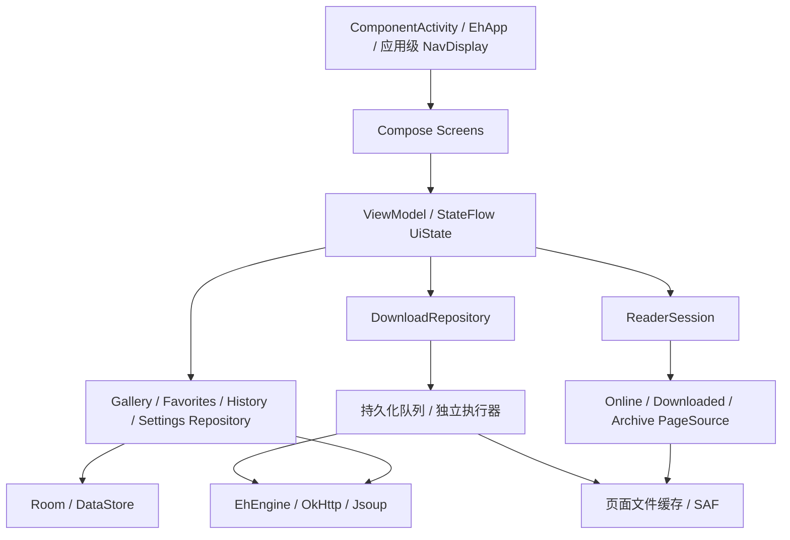

# Compose / Kotlin 重构方案

日期：2026-10-30。范围：基于当前工作区的源码评估；本轮只新增方案文档，没有修改应用代码或执行构建。

补充范围：用户已明确“先实现 Compose，不考虑支持 iOS”。当前交付优先 Android Compose；为以后 Android + Desktop/JVM 的 KMP/CMP 复用保留边界，不在本轮建立 iOS source set 或实现。

## 1. 结论与边界

建议采用「保留站点协议和数据兼容性，重做应用壳、阅读器及状态管理」的路线。目标是 Kotlin 编写应用逻辑、Compose 编写界面，删除项目的 NDK/CMake/JNI 和自研 GL 阅读框架。

本方案把“去原生层”定义为：应用不再维护 C/C++、NDK/CMake 和自定义 JNI，也不以预编译 libarchive AAR 代替原有原生压缩层。可以调用 Android 框架的图片解码、Canvas、SQLite 和 JDK API；成熟的纯 JVM Java 库可以由 Kotlin 调用。上一版把这个目标扩大成“所有平台、所有依赖都不能含原生二进制”过于严格：未来桌面 CMP 使用的 Skia/Skiko 等官方渲染运行时应按平台正常打包，不在删除范围内。

旧的 `tech-stack-upgrade-report.md` 保留作历史记录。其“预编译 libarchive AAR”路线只解决本机不装 NDK，仍携带原生库，不作为本次目标方案。旧报告中的工作量、构建结果不能作为本方案的验证结果。

## 2. 当前代码的实际状态

| 范围 | 源码事实 | 重构影响 |
|---|---|---|
| 工程 | 单一 `:app`，244 个 Kotlin 文件、108 个 Java 文件；`minSdk=31`、`targetSdk=36` | 已有 Kotlin 基础，无须创建另一套应用重写协议 |
| Compose | 已接入 Compose、Material 3 Expressive 和 Navigation 3；站点选择、进度、画廊信息、预览图、评论、登录、Cookie 登录、手势锁、历史、收藏、画廊列表、下载、详情、阅读器、Web 登录十五个 Scene 全部是 `EhComposeScene`，**XML Scene 已清零** | 依赖可复用，尚未形成应用级导航宿主 |
| 导航 | `MainActivity` 继承 `StageActivity`；`EhComposeScene` 继承 `SolidScene`，每个实例内又创建 `NavDisplay` | 这是迁移桥，最终需收敛到应用级导航宿主 |
| 大页面 | 已全部拆分：详情 1053 + 925，列表 770 + 1013，收藏 579 + 598，下载 482 + 1042（前者 Scene 管状态与请求，后者 Screen 是纯 UI）；四页共用 `component/GalleryItems.kt`（399 行）与 `component/SearchPanel.kt`（518 行） | 先抽业务与状态，再替换界面，避免把大 Scene 原样搬进 Composable |
| 阅读器 | `GalleryActivity` 1305 行；`glview`/`glgallery` 共 49 个文件 | 阅读器需要单独重做，不能只替换 XML |
| 图片管线 | `SpiderQueen` 下载后直接 `Image.decode()`；`GalleryProvider` 用 GL idle 回调分发已解码图片 | 下载、图片解码、渲染相互耦合，是首要拆分点 |
| 网络 | `EhEngine` 已有类型化的 `suspend` 方法；外层 `EhClient` 仍用整数方法码、`Any?` 参数与 callback | 可直接复用 Engine 和解析器，逐步删除请求分发表 |
| 数据 | 已用 Room；主库版本 4，`exportSchema=false`，`allowMainThreadQueries()`；DAO 多为同步方法 | 先补 schema 基线，再迁移 `suspend`/`Flow`，最后移除主线程查询 |
| 设置 | 839 行全局 `Settings`，基于 SharedPreferences | 先提供可观察接口，再做 DataStore 迁移 |
| 后台下载 | `DownloadManager` 1235 行，全局可变队列、listener、Handler；已有 `dataSync` 前台服务 | 需要独立于界面生命周期的队列与执行器 |
| 构建发布 | CMake 拉取 libarchive、xz、nettle；Gradle 和 CI 都按 ABI 拆包、上传原生符号 | 源码替换后还要同步清理 Gradle、Manifest 和两个发布 workflow |
| 测试 | 当前没有 `src/test`、`src/androidTest` 目录 | 先建立关键协议、档案和数据迁移样本，不能仅以编译通过验收 |

以上计数不包含构建产物。工作区已有未提交的 Compose 和依赖改动，本方案在此基础上评估。

### 2.1 收藏页结构决策（已落地，供后续列表页参照）

收藏页是第一个「带分类抽屉 + 分页 + 多选 + 修改收藏」的完整列表页，可作为列表/下载页迁移的参照样板。

- **抽屉归属**：分类列表放进场景内的 `ModalNavigationDrawer`，并设 `gesturesEnabled = false`，只由顶栏「收藏夹」图标打开。左侧边缘手势仍归属宿主 `DrawerLayout` 的 START 抽屉，避免两个左侧抽屉抢同一手势；宿主 END 抽屉不再为收藏页提供内容（`FavoritesScene` 不再覆写 `onCreateDrawerView`），左侧导航抽屉照旧由顶栏菜单图标 `toggleDrawer(START)` 打开。
- **顶栏三态**：标题态（标题 + 搜索/收藏夹/溢出菜单）、搜索态（自动聚焦 + `Search` IME 动作）、多选态（关闭 + 已选数 + 全选/下载/删除/移动）。
- **操作入口收敛**：原 8 个 FAB 折叠成「刷新 FAB + 溢出菜单（跳到日期 / 末页，仅云分类可见）」，旧的 FAB 折叠动效不再保留。
- **分页显式化**：`next` 承接服务端游标，`prev=1-0` 表示末页，`seek` 传日期字符串，与旧 `GalleryInfoContentHelper.goTo(Long, Boolean)` 语义一致；本地分类直接查 `EhDB`。日期选择用 `MaterialDatePicker`（DialogFragment）挂在 `supportFragmentManager`，区间约束保持 2007-03-21 ~ 昨天。
- **修改收藏沿用旧机制**：先置 `enableModify`，下一次加载先发 `MODIFY_FAVORITES` / `ADD_FAVORITES_RANGE`，应答同时充当列表刷新，再由 `updateHistoryFavSlot` 同步历史记录里的收藏槽位。这样删除/移动/加入云端仍是一次网络往返。
- 返回键顺序：取消多选 → 退出搜索 → 关闭页面；`getNavCheckedItem()` 仍是 `nav_favourite`。
- **已知取舍**：列表固定单列卡片，未接 `Settings.listMode` 网格模式；需要在 `GalleryListScene` 迁移、抽出统一列表组件时一起处理，否则会出现两套列表布局逻辑。（已于 2.2 一并解决。）

### 2.2 画廊列表页结构决策（已落地，列表/下载页的最后一块样板）

列表页是首页、订阅、热门、榜单、任意搜索结果的共同宿主，也是唯一同时具备「搜索面板 + 分页游标 + 项目上下文菜单 + 抽屉」的页面，因此它的结构决定了后续详情/下载页的写法。

- **共享条目组件**：新增 `ui/compose/component/GalleryItems.kt`，从旧 `item_gallery_list.xml` / `item_gallery_grid.xml` + `GalleryAdapter` 提炼出 `GalleryItem(info, layout, …)`。收藏页与列表页共用同一份卡片，`Settings.listMode`（`GalleryItemLayout.LIST/GRID`）是唯一开关，收藏页因此顺带补上了网格模式。
- **共享搜索面板**：新增 `ui/compose/component/SearchPanel.kt`，替代旧 `SearchLayout` + `search_*.xml`：分类从 `CheckTextView` 表改成 `FlowRow` chip（选中=包含，长按=其余取反）、搜索模式改成单选行、进阶条件（`SH/STO/SFL/SFU/SFT`、最低星级、页数区间）保留原校验文案；图片搜索页签保留「选图 → 计算 SHA-1 → `f_shash`」链路。条件装配集中在 `SearchPanelState.buildCriteria()`，纯逻辑并有单测覆盖。
- **顶栏三态**：标题态（点标题进简单搜索 + 菜单/搜索/抽屉/溢出）、简单搜索态、展开搜索态（正文换成搜索面板）。简单搜索沿用旧规则：`reset()` 后只保留「订阅搜索」模式。
- **抽屉**：右侧「快速搜索 / 榜单时间范围」抽屉搬进场景内的 `ModalNavigationDrawer`，用外层 `LayoutDirection.Rtl` 镜像到右侧、`gesturesEnabled = false` 只由顶栏打开；左侧导航抽屉仍归宿主。快速搜索支持选、删、拖拽排序（固定 56dp 行高估算目标下标，拖拽结束一次性写库）。
- **FAB 收敛**：4 个 mini FAB + primary 折叠动效改成「刷新 FAB + 溢出菜单（跳到日期 / 按 gid 跳 / 末页 / 榜单页码 / 列表-网格切换 / 添加快速搜索）」；长按条目是上下文对话框（阅读 / 下载或删除下载 / 收藏或取消收藏 / 移动下载标签），与旧行为一致（本页旧实现同样没有多选）。
- **分页承载**：非榜单用 `prev`/`next` 游标（`nextIndex` 承接 `result.next`），榜单用页码（`seek`/`p=`，`result.pages` / `result.nextPage`）；收藏槽位与下载角标不再重建列表，而是就地改 `GalleryInfo` 并自增快照版本号。
- **已知取舍**：① 搜索栏「粘贴画廊/分页 URL 的跳转建议」已在 2.7 补回；② 缩略图 → 详情页的共享元素转场降级为普通 Scene 转场；③ `WindowInsetsAnimationCompat` 的 FAB 与 IME 同步位移、`SearchBarMover` 的滚动隐藏搜索栏、`FabLayout` 折叠动效不再保留；④ 未迁移接收外部分享图片（`onReceiveContent`）的入口；⑤ 旧 `SearchBar`/`SearchLayout`/`CategoryTable`/`ImageSearchLayout` 类与其 `search_*.xml` 已在 2.5 整体删除。
- **验证**：`compileDebugKotlin`、`spotlessCheck`、`testDebugUnitTest`（新增 `SearchPanelStateTest`）、`assembleDebug` 全绿；已验证 `scene_gallery_list.xml`、`menu/drawer_gallery_list.xml`、`menu/quicksearch_option.xml` 无引用并删除。

### 2.3 下载页结构决策（已落地）

下载页没有网络请求，全部状态来自 `DownloadManager` 的内存表，所以迁移重点是「可变对象 → 不可变快照」和「操作台从 FAB 搬到顶栏」。

- **数据快照**：`DownloadsScene` 每次收到 `DownloadInfoListener` 回调或用户操作后重建 `infos: List<DownloadInfo>`（过滤 + 排序），再由 `uiState()` 映射成 `DownloadItemUi`（state/finished/total/speed/legacy 全部按值拷贝）。旧实现直接改 `RecyclerView` 的 `notifyItemChanged`，Compose 侧若不这样做会读到可变对象旧字段而不刷新。
- **派生顺序与旧实现一致**：先按 label 取列表（`allDownloadInfoList` / `defaultDownloadInfoList` / `getLabelDownloadInfoList`），再用 `mType` 槽位过滤（`-1` 全部、`0..4` 状态、`5` 标题关键字，保留旧实现关键字与状态共用槽位的 or 语义），最后按 11 种排序比较器排（`0..9` 见 `R.array.download_sort`，`10` 随机）。
- **抽屉**：右侧「下载标签」抽屉搬进场景内的 `ModalNavigationDrawer`（RTL 镜像、`gesturesEnabled = false`）；条目显示 `标签 [数量]`，前两项（全部 / 默认）不可拖动，真实标签可长按拖拽排序（`DownloadManager.moveLabel(from-2, to-2)`），长按弹出重命名 / 删除，顶栏两个图标负责「新建标签」「默认标签」。
- **操作台**：7 个 FAB（全选 / 置顶 / 开始 / 停止 / 删除 / 移动 + 关闭）改成「多选顶栏 = 关闭 + 已选数量 + 全选 + 溢出菜单」；删除带「同时删除图片文件」勾选（`Settings.putRemoveImageFiles`，勾选后写 `SpiderDen.getGalleryDownloadDir` + `removeDownloadDirname` 再异步删文件），移动列出「默认 + 全部标签」。
- **顶部菜单**：过滤（状态单选 + 标题关键字）/ 全部开始 / 全部停止 / 溢出（排序、反向全部开始、重置阅读进度、打开标签抽屉）；旧实现「改排序即写回 `Settings.putDefaultSortingMethod`」的行为保留。
- **列表布局**：`AutoStaggeredGridLayoutManager(Settings.detailSize)` 换成 `LazyVerticalGrid(GridCells.Adaptive(132.dp))`，`key = gid`；`KEY_GID` 进入时在 `LaunchedEffect` 里 `scrollToItem`（替代旧的 `mInitPosition` 延迟滚动）。
- **已知取舍**：① 去掉 `FastScroller` 与主列表的手动拖动置顶（顺序改由排序菜单与「置顶」多选操作控制）；② 卡片是统一高度（封面 2:3 + 标题 + 一行状态/进度），旧实现的 `SimpleItemAnimator.supportsChangeAnimations=false` 对应的「不发生形变」效果自然成立；③ 缩略图点击进详情保留，但共享元素转场降级为普通 Scene 转场（与列表页同一取舍）；④ 移除了旧的 `move` 拖拽手柄，`state == DOWNLOAD` 时不再隐藏上传者/分类（改为固定占位，避免卡片高度跳变）。
- **验证**：`compileDebugKotlin`、`spotlessCheck`、`testDebugUnitTest`、`assembleDebug` 全绿；`scene_download.xml`、`item_download.xml`、`menu/scene_download.xml`、`menu/drawer_download.xml`、`menu/download_label_option.xml`、`layout/drawer_list_rv.xml`、`layout/item_drawer_list.xml` 已确认无引用并删除。

### 2.4 详情页结构决策（已落地）

详情页是唯一带「标签 + 评分 + 归档/种子 + 评论/预览联动 + 共享元素转场」的页面，也是最后一块。它的状态比列表页更碎，但本质仍是「一次请求 + 一堆派生视图」。

- **状态机**：旧 `ViewTransition` 的五态收敛成 `DetailPhase`（`INIT` / `REFRESH` / `REFRESH_HEADER` / `NORMAL` / `FAILED`）单值状态；`REFRESH_HEADER` 表示「头部已缓存、正文在重载」，由 Compose 侧渲染成「头部 + 局部 loading」。缓存仍走 `galleryDetailCache` + `application.putGlobalStuff()` 防重复请求。
- **快照**：`uiState()` 每次从 `GalleryDetail` 派生 `TagGroupUi` / `CommentUi` / `PreviewUi`；`downloadState`、`startPage`、`localFavorites` 是 Compose 状态字段，`version` 负责在就地改 `GalleryDetail` 字段（收藏、评分、投票）后触发重组。**`EhDB.containLocalFavorites()` 这类 DB 查询放在 `onResume` 里做，不进 `uiState()`**，否则每次重组都会查一次库。
- **头部**：`back_action` / `other_actions` 换成 `TopAppBar` 的返回与溢出菜单（刷新 / 添加标签 / 清除图片缓存 / 用其他应用打开），标题 + 上传者 + 分类放在渐变信息区，上传者与分类仍可点（筛选）与长按（加过滤）。
- **信息与操作**：信息行（语言 / 页数 / 收藏数 / 发布时间 / 大小）与「更多信息」仍进 `GalleryInfoScene`；下载按钮按 `DownloadState` + `hasNewerVersions` 显示 `download` / `download_upgradeable` / 各状态文案，长按强制下载到默认目录；收藏点击走 `CommonOperations.addToFavorites/removeFromFavorites`（长按 = 快速选择槽位），角标状态由 `localFavorites` + `isFavorited` 决定；分享 / 种子数 / 归档 / 相似画廊一行排开。
- **标签**：`AutoWrapLayout` 换成 `FlowRow` chip，`_W`（弱化）、`_L`（锁定/斜体）、`_U`/`_D`（已投票）语义保留，翻译仍走 `EhTagDatabase`（`Settings.showTagTranslations` 开关不变）；点击按 tag 搜索，长按菜单保留复制 / 查看定义 / 加入过滤 / 上投票 / 下投票（未登录时隐藏投票项）。
- **评论 / 预览**：评论预览取前 2 条，正文仍用 `Html.fromHtml` 生成 `Spanned`，再在组合期用主题链接色转成 `AnnotatedString`；点评论进 `GalleryCommentsScene`（仍带 `setRequestCode`，返回时用 `KEY_COMMENT_LIST` 回填）。预览图用 `PreviewSet.getGalleryPreview(gid, i)` 的 `imageKey` / `imageUrl` 走 coil，列宽跟随 `Settings.previewSize`，点击直接进 `GalleryActivity` 对应页。
- **归档 / 种子 / 评分**：三个对话框保留原 XML（`dialog_archive_list` / `dialog_torrent_list` / `dialog_rate` + `GalleryRatingBar`），逻辑从旧 helper 原样搬进 Scene：归档列表带资金显示与 `METHOD_DOWNLOAD_ARCHIVE`，种子列表用系统 `DownloadManager` 并带上 Cookie，评分用 `METHOD_GET_RATE_GALLERY` 并就地更新 `rating` / `ratingCount`。
- **已知取舍**：① 列表/下载 → 详情的**共享元素转场彻底取消**（`EnterGalleryDetailTransaction` 已删除；Compose 场景无法在 `onCreateView` 之后再建 `ViewTransition`）；② 头部 `CircularReveal` 渐入动画不再保留；③ 「已下载但有新版本」不再弹升级重下对话，改为普通的删除/重新下载入口（`download_upgradeable` 文案仍在）；④ 评论正文里的图片（`URLImageGetter`）不再加载，纯文本与链接保留；⑤ `onReceiveContent` 的外部分享图片入口未迁移；⑥ 未保留 `ViewTransition` 的下拉刷新手势，刷新走溢出菜单。
- **验证**：`compileDebugKotlin`、`spotlessCheck`、`testDebugUnitTest`、`assembleDebug` 全绿；`scene_gallery_detail.xml`、`gallery_detail_{header,content,actions,tags,comments,previews,info}.xml`、`menu/scene_gallery_detail.xml` 与 `EnterGalleryDetailTransaction.kt` 已确认无引用并删除。

### 2.5 旧 XML 控件栈退役（清理片）

14 个页面全部迁完后再扫一遍「谁还在引用旧控件」，把已经悬空的一整条栈删掉，避免下一个人误以为还有两套实现。

- **删除的类**：`widget/SearchBar.kt`、`widget/SearchLayout.kt`、`widget/CategoryTable.kt`、`widget/ImageSearchLayout.kt`、`widget/FabLayout.kt`、`widget/SearchBarMover.java`、`view/BringOutTransition.java`。这些类的剩余引用只有彼此之间的互引与注释，宿主已全部是 Compose。
- **删除的布局**：`search_action.xml`、`search_advance.xml`、`search_category.xml`、`search_image.xml`、`search_normal.xml`、`widget_category_table.xml`、`widget_image_search.xml`、`widget_search_bar.xml`、`item_simple_list_2.xml`（搜索建议列表，随 `SearchBar` 一起退役）。
- **顺带清掉的孤儿布局**（按「全仓代码 + XML 交叉引用」扫出来、零引用的）：`dialog_recycler_view.xml`、`gallery_tag_group.xml`、`item_gallery_tag.xml`、`item_gallery_comment.xml`、`item_gallery_preview.xml`、`item_hosts.xml`、`preference_recyclerview.xml`。
- **刻意保留**：`widget/AdvanceSearchTable.kt`（`SH`/`STO`/`SFL`/`SFU`/`SFT` 位常量仍被 `SearchPanel`、`ListUrlBuilder`、`EhEngine` 引用）、`easyrecyclerview/FastScroller.kt`（仍被 `ContentLayout` 使用）、`GalleryAdapter` + `item_gallery_list.xml`/`item_gallery_grid.xml`（`GalleryActivity` 阅读器还在用）、`dialog_rate.xml`/`dialog_archive_list.xml`/`dialog_torrent_list.xml`/`item_select_dialog.xml`（详情页三个对话框）。
- **验证**：删除后 `compileDebugKotlin`、`spotlessCheck`、`testDebugUnitTest`、`assembleDebug` 全绿；孤儿扫描脚本（代码 `R.layout.x` / `@layout/x` 双向匹配）复扫结果为 0。

### 2.6 Web 登录页迁移（XML Scene 清零）

`WebViewSignInScene` 是最后一个 `SolidScene`。它本来就没有 XML 布局（WebView 是代码构造的），所以迁移只是把它接进 Compose 树，逻辑一行没改：

- `WebViewSignInScene : EhComposeScene()`，`startRoute = EhRoute.WebViewSignIn`，`needShowLeftDrawer() = false` 保留（登录页不该有导航抽屉）。
- 新增 `ui/compose/screen/SignInWebViewScreen.kt`：`AndroidView(factory = { createWebView() })` + 顶部 `LinearProgressIndicator`（`onProgressChanged` 上报，1..99 时才显示），WebView 背景改透明跟随 Compose 主题（旧实现固定取 `android.R.attr.colorBackground`）。
- 行为保持不变：进入时 `CookieManager.flush/removeAllCookies/removeSessionCookies` + `EhCookieStore.loadForWebView(URL_SIGN_IN, cloudflare)`；`onPageFinished` 里抓到 `ipb_member_id` + `ipb_pass_hash` 就 `signOut()` 后写入 `DOMAIN_EX` / `DOMAIN_E` 的持久 Cookie，然后 `setResult(RESULT_OK)` + `finish()`；Cloudflare Cookie 单独落库。`onDestroyView` 里 `destroy()` WebView。
- `activity_webview.xml` 保留：`MyTagsFragment` / `UConfigFragment` 仍在 inflate 它。
- **验证**：`compileDebugKotlin`、`spotlessCheck`、`testDebugUnitTest`、`assembleDebug` 全绿；`ui/scene` 下已无 `SolidScene`/`BaseScene` 子类（15 个 Scene 全部 Compose）。

### 2.7 粘贴链接的跳转建议（补回 2.2 的取舍 ①）

列表页顶栏改 Compose 时丢掉了旧 `SearchBar.SuggestionProvider` 的能力：搜索框内容若是画廊链接，会多出一行「打开画廊」。现在补回来了，并且顺手把它抽成了可测的纯函数。

- **纯函数**：`ui/compose/screen/UrlSuggestionUi.kt` 里是模型 `UrlSuggestionUi`（`Detail(gid, token)` / `Page(gid, pToken, page)`）与 `parseUrlSuggestion(text)`，解析顺序与旧实现一致：先 `GalleryDetailUrlParser`，再 `GalleryPageUrlParser`，都不匹配返回 null（此时按普通关键字搜索）。
- **状态管线**：`parseUrlSuggestion` 只在 `uiState()` 里调用一次，结果作为 `suggestion` 进快照；UI 只在搜索态（简单搜索 / 展开搜索）且 `suggestion != null` 时，在顶栏下方渲染一行 `UrlSuggestionRow`（书本图标 + `gallery_list_search_bar_open_gallery`），点击后由 Scene 决定去向：
  - `Detail` → `GalleryDetailScene` 的 `ACTION_GID_TOKEN`；
  - `Page` → `ProgressScene` 的 `ACTION_GALLERY_TOKEN`（带 `pToken` 与 `page`）；
  - 两种情况都会把顶栏切回标题态，与旧实现「点建议即退出搜索」一致。
- **测试**：新增 `GalleryUrlSuggestionTest`（详情链接 / 分页链接 / 普通关键字 / 空白 / 详情优先 五组用例）。旧实现写在 `SearchBar.SuggestionProvider` 里无法单测，这也是这次把它抽成顶层函数的主要理由。
- **验证**：`compileDebugKotlin`、`spotlessCheck`、`testDebugUnitTest`、`assembleDebug` 全绿。

## 3. 四组 JNI 的替代

### 3.1 SHA-1：直接改成 Kotlin 调用 MessageDigest

入口在 `unifile/UniFileExtensions.kt`，当前新开 fd 后调用 `jni.sha1(fd)`。改为 `openInputStream().use`，分块更新 `MessageDigest("SHA-1")`，输出相同的小写十六进制。

保持协议要求的 SHA-1：图片搜索和远端文件校验不能擅自换算法。统一在 IO dispatcher 执行，保留流关闭语义，读失败应抛错而不是返回部分摘要。

### 3.2 GIF：优先删除补丁，使用 Coil 已有实现

当前 `EhApplication` 注册的是 `AnimatedImageDecoder.Factory(false)`，关闭了 Coil 的最小帧延迟处理，然后 `image/Image.kt` 在 Android 12/13 上通过 JNI 检测、mmap 和修补 GIF。

核实项目正在使用的 **Coil 3.5.0 源码**：`AnimatedImageDecoder.Factory` 的默认参数在 API 34 以下开启修补，`FrameDelayRewritingSource` 已实现同类逻辑。因此第一选择是恢复默认配置，并删除应用层补丁；保留修补前后的动图样本验证播放和源文件不变，再决定是否需要兼容层。

旧 C 逻辑遇到正常延迟会提前结束扫描，Coil 的实现不必与它逐字节一致，应以播放行为验收。GIF 延迟单位是 1/100 秒，常量 `2`、`10` 对应 20ms、100ms，旧报告的 2ms、10ms 描述不准确。

来源：[Coil 3.5.0 AnimatedImageDecoder](https://github.com/coil-kt/coil/blob/3.5.0/coil-gif/src/main/java/coil3/gif/AnimatedImageDecoder.kt)、[同版本修补实现](https://github.com/coil-kt/coil/blob/3.5.0/coil-gif/src/main/java/coil3/gif/internal/FrameDelayRewritingSource.kt)。

### 3.3 压缩包：Kotlin 统一接口，纯 JVM 库负责格式

| 格式 | 建议实现 | 边界与验证 |
|---|---|---|
| ZIP / CBZ | Zip4j；若明确不支持加密，可仅用 `java.util.zip.ZipFile` | Zip4j 支持 AES、ZipCrypto 和 ZIP64；验证中文文件名、密码、损坏条目、排序 |
| 7z / CB7 | Commons Compress `SevenZFile` + XZ for Java | 需要随机访问输入；不同 method、固实包、加密头、大字典不能笼统承诺完全兼容 |
| TAR / CBT、gzip、xz | Commons Compress + XZ for Java | 建索引后按需解到磁盘缓存，避免每次翻页从头解包 |
| RAR / CBR | **本期不支持**（Junrar 8.x 保留为候选，需要时再作为独立 backend 加回） | 压缩包画廊唯一入口是 `GalleryActivity` 的 `Intent.ACTION_VIEW`（`GalleryActivity.kt:246`），app 内下载/阅读走 `SpiderDen` 散文件，不受影响；RAR 属长尾格式，且 Junrar 的 RAR5/分卷/加密行为未经验证。改为按 `Rar!\x1A\x07` 魔数识别后给出可读的能力错误 |

**为什么放弃 RAR**：入口窄（仅外部打开文件）、CBZ/ZIP 是绝对主流、可省掉一个未验证后端与一套异常语义。决定可逆——将来需要时只需新增一个 backend，不必改动其他格式的实现。

来源：[Zip4j](https://github.com/srikanth-lingala/zip4j)、[Commons Compress 格式限制](https://commons.apache.org/proper/commons-compress/limitations.html)、[7z 使用与随机访问说明](https://commons.apache.org/proper/commons-compress/examples.html)、[Junrar 8.1.2 README](https://github.com/junrar/junrar/blob/v8.1.2/README.md)、[发布变更](https://github.com/junrar/junrar/blob/v8.1.2/CHANGELOG.md)、[Maven Central POM](https://repo.maven.apache.org/maven2/com/github/junrar/junrar/8.1.2/junrar-8.1.2.pom)。

实现约束：

- 使用每个压缩包独立的 `ArchiveSession`，替代当前 C 层全局 archive、密码和条目状态。
- 输入以 URI 为边界。云盘或 SAF provider 可能不给可 seek 的 fd，先按需暂存成受配额约束的本地文件；不能假设 `statSize` 总是已知。
- 条目以内部 ID 区分，展示名和缓存路径分离，处理重名、子目录和自然排序；如 `2.jpg` 应排在 `10.jpg` 前。
- 解压结果优先写入有大小限制的磁盘缓存，暴露可重新打开的文件/URI，不继续返回手动释放的 direct ByteBuffer。
- 固实包顺序提取并复用缓存；不能给同一个非线程安全 archive reader 并发读多个条目。
- 限制字典内存、单项及累计解压大小；将取消、错误密码、损坏、格式不支持分别建模。不要直接把条目名称拼接为输出路径。
- 密码按会话持有。旧版持久化密码的兼容行为单独迁移，不把密码放进路由或 UI SavedState。
- 不添加 libarchive AAR、SevenZipJBinding、zstd-jni 等重新携带 `.so` 的依赖；依赖版本和传递依赖需要审计。

### 3.4 GL 纹理上传：随阅读器整体删除

最终删除 `nativeTexImage`、`com.hippo.glview`、`com.hippo.glgallery` 和旧 `com.hippo.image.Image` 渲染包装。长期目标不做 Kotlin GLES 直译，否则还保留整套纹理、线程和生命周期复杂度。

新阅读器分三条显示路径：

1. 分页静态图片：优先采用参考项目的 Coil 3 + Telephoto 路线，使用已完成的本地原图作为解码源，复用缩放、平移和支持格式的区域解码能力，不从零实现整套图片手势与瓦片引擎。
2. 条漫/超长图：参考 Legado 的视口瓦片窗口 + 分段 LazyColumn 行，Android 由 `BitmapRegionDecoder` 实际解码。只解码可见区域及有限预热区域，设置内存预算；按格式检测能力，不能假设所有格式都能分块。区域解码与调度、几何分开，具体适配见第 9 节。
3. GIF/动态 WebP：Coil + 平台 `ImageDecoder`，只让可见页播放，离屏停止；不把每帧转成旧 GL 纹理。

横向阅读使用 Foundation Pager，滚动阅读使用 LazyColumn。分页图片的缩放/平移优先交给图片组件，条漫的整体缩放/滚动由列表层持有，避免两层手势各自修改位置；覆盖 RTL、双击定位、边界翻页和缩放中心保持。

`AsyncImage + graphicsLayer(scale)` 不等于大图阅读器：它不会自动提供区域解码，原尺寸整图可能导致 OOM，降采样整图又会丢失放大细节。

平台能力来源：[BitmapRegionDecoder](https://developer.android.com/reference/android/graphics/BitmapRegionDecoder)、[Coil GIF 支持](https://coil-kt.github.io/coil/gifs/)。

## 4. 目标架构



先在 `:app` 内按 `app`、`core`、`data`、`feature` 划分包，接口稳定后再按编译隔离收益拆 Gradle 模块。不要在第一步就拆十几个模块。

- **应用层**：根路由、主题、启动检查、Intent/深链转换、依赖装配。保留现有 `EhRoute` 的可序列化思路，路由传 gallery ID、token、页码或 URI 标识，不传 Bitmap、完整列表或临时对象 ID。
- **界面层**：每个功能有 Route/Screen、ViewModel、不可变 UiState；Screen 接收状态和事件。使用 `collectAsStateWithLifecycle()`，请求由 ViewModel/Repository 发起。
- **数据层**：优先复用 `EhEngine`、解析器、Cookie/DNS/代理、标签数据和 Room entity。新界面调用类型明确的 Repository，逐步退出 `EhClient.execute(Int, Any?)`。
- **阅读层**：`PageSource` 提供页面元信息、可重新打开的图片数据和加载状态；不负责解码 Bitmap，不依赖 GL、Activity 或 Compose。
- **下载层**：与 Reader 共享文件、请求去重和限流，但下载任务不归 ReaderViewModel 管；退出阅读器不能取消用户主动下载。

导航桥只服务过渡。不要继续把新功能都封装成各自持有 NavDisplay 的 Scene。先建立应用级宿主，未迁页面通过受控的旧界面入口过渡，按功能链路切换，完成后删除桥接层。

应用级宿主不要求所有 UI 状态塞入同一列表；未来若有多栏或独立 tab 历史，可以显式管理。首先应消除旧 Scene 栈与页面内部 Nav3 栈的重复导航所有权。

依据：[Compose 单向数据流](https://developer.android.com/develop/ui/compose/architecture)、[Navigation 3 状态与 ViewModel 作用域](https://developer.android.com/guide/navigation/navigation-3/save-state)。

## 5. 数据与后台任务

### 保留用户已有数据

- 保留 `applicationId`、签名、`eh.db`、Cookies 数据库、下载目录、`.ehviewer` 元信息与 SAF 授权的兼容性；debug 包与 release 包的数据不同，测试时要区分。
- 为现有 Room v4 导出 schema 作为迁移起点；同步 DAO 的调用先移到 IO，再改为 `suspend`/`Flow`，最后移除 `allowMainThreadQueries()`，不能直接删开关导致旧页面崩溃。
- 设置过渡期先把 SharedPreferences 通过 listener 暴露成 Flow，使新旧页面读取同一来源。旧写入点退场后再用 SharedPreferencesMigration 一次切到 DataStore，避免两套存储互相覆盖。
- 主题从 SettingsRepository 的 Flow 读取。现有 `EhTheme` 的 `remember { isDark && Settings.blackDarkTheme }` 只保存初始值，无法可靠跟踪开关和深色状态变化，重构时一并消除。
- 保留现有安全锁、登录、站点选择的启动顺序，并将被拦截的深链保存为待处理目标；登录后继续原目标。

### 重做下载执行边界

Room 保存任务状态和页级完成信息，内存只保存运行中任务；建立排队、下载、暂停、失败、完成状态机。请求与解码分别限流，进度更新节流后再送 UI，通知与页面订阅同一数据源。

不建议把所有下载机械改成 WorkManager。用户点击的长时间下载优先评估 Android 14+ UIDT Job；Android 12/13 保留前台服务后端，延迟同步任务交给 WorkManager。UIDT 的启动条件、通知、取消、任务停止和恢复都需要具体实现验证。

当前 targetSdk 36，现有 `dataSync` 服务必须覆盖 Android 15+ 后台运行时限与 `onTimeout()`。官方说明此类型在后台受 24 小时内累计 6 小时的限制，不能假设前台服务能无限运行；长时间 Worker 同样不能自然绕过限制。

依据：[后台数据传输选择](https://developer.android.com/develop/background-work/background-tasks/data-transfer-options)、[前台服务时限](https://developer.android.com/develop/background-work/services/fgs/timeout)。

## 6. 推荐实施顺序

| 阶段 | 实施范围 | 完成条件 |
|---|---|---|
| P0：基线 | 固定当前依赖组合，整理功能清单、HTML/JSON、档案、GIF、大图和旧数据样本；导出主库 schema | 记录可重现的旧行为；不能把旧报告“编译通过”当成本轮结果 |
| P1：边界 | 引入 Repository 和不含 Bitmap 的 PageSource；先拆 SpiderQueen 的抓取、缓存与解码职责 | 新 Reader 可以复用现有协议和缓存而不依赖 GL；旧页面仍可运行 |
| P2：去 JNI 的主线 | SHA-1 改 JVM；验证 Coil 默认 GIF；实现 ArchiveSession；完成 Compose Reader 的在线/离线/压缩包入口 | 阅读器覆盖翻页、缩放、长图、动图、保存、进度恢复、RTL、音量键；关键档案样本通过 |
| P3：去原生构建 | 删除全部 JNI 调用和 loadLibrary，再删 cpp、NDK/CMake、ABI 拆包、原生符号任务；清理 GL Manifest 要求与 CI 产物路径 | 无 NDK/CMake 环境完成 debug/release 构建；最终 APK/AAB 无 libehviewer/libarchive 等应用原生层，并审计其他 native 依赖 |
| P4：Compose 应用壳 | ComponentActivity、应用级 Nav3、启动门禁、主题、深链、登录/设置/历史链路 | 返回、进程恢复、设置即时生效、外部文件与分享入口可用；过渡桥边界明确 |
| P5：主要业务页面 | 列表→详情→评论/预览→收藏→下载，逐条链路替换 Scene（全部完成，15 个 Scene 均为 Compose，XML Scene 清零） | 分页、筛选、搜索、选择操作与业务错误完整；下载不随页面销毁 |
| P6：数据和下载收尾 | 全部 DAO 异步化、DataStore 最终切换、持久队列与后台执行后端 | 升级旧数据、取消恢复、断网、进程重建验证通过 |
| P7：删除遗留层 | Scene/Stage/Announcer、旧 Preference/XML 页面、无调用的自研 View 和工具类、AppCompat/Rikka 依赖按引用清理 | 全应用功能经新路径；Lint、构建和关键回归通过 |

P2 的阅读器必须提前：它直接决定能否删除 JNI，不能放到全部 UI 迁移之后。P4 的应用壳可在 P1/P2 稳定后交错推进，不必等待所有设置页或旧页面迁完才开始根导航。

首批实现宜集中在 **PageSource + Compose Reader + 纯 JVM 压缩包适配 + SHA-1/GIF 清理**，而不是继续增加外观试验页，也不投入一轮最终要删除的 Kotlin GLES 翻译。

## 7. 验收重点

- **构建**：全新环境不装 NDK/CMake；执行 `assembleDebug`、`assembleRelease` 与适用的单元测试/Lint；检查 APK 的 `lib/` 及 AAB 的 native library 条目，确认应用原生层已移除。未来桌面 CMP 的框架 native runtime 单独审计，不沿用“所有产物绝对不能有 native 文件”的标准。
- **压缩包**：ZIP/加密 ZIP、7z/固实/加密头、TAR；RAR 与 tar.gz/tar.xz 明确报能力错误而不是静默失败。包含中文、重名、空包、未知大小 URI、取消、多个会话和自然排序。
- **阅读器**：正常图片、大图、长图、GIF、动态 WebP；连续翻页的内存峰值/帧时间/解码耗时记录；不能只验证单张图能显示。
- **资源生命周期**：快速退出/切换书本时 fd、decoder、缓存 lease 正确释放；解码未完成前文件不会被清理；下载和阅读使用同页时请求可复用。
- **兼容**：真实旧数据库/偏好/下载目录升级后收藏、历史、阅读位置、队列和授权保持；保留签名与包名的升级安装验证。
- **系统行为**：Android 12/13 和 14+ 的后台执行分别验证；通知暂停恢复、超时、进程死亡、深链门禁、返回和预测性返回作为独立场景。

当前未执行依赖替换、构建或真机回归；压缩库的 Android 运行能力、阅读器性能和完整功能对等性仍是实施阶段的验证项。可以去掉 NDK 的判断来自调用范围与替代实现的源码核实，不等于重构已经完成。

## 8. KMP/CMP：Android Compose 先落地，桌面按边界演进

### 8.1 现状与承诺

目前 Eh 和参考工程都不能称为已完成的 KMP/CMP 应用。Eh 当前只有 Android target；Legado 的 AGENTS 和现代化文档也明确其为 Android-first 渐进迁移仓库。使用 Compose、Kotlin 或声明 `commonMain` 候选，并不证明能在桌面运行。

本次以 Android Compose 功能完成为主，不为尚无消费者的能力创建空 KMP 模块。模型、会话、文件接口和 renderer 的边界从一开始按可拆分方式编写；桌面实际启动时，再提升有真实消费方的共享部分并添加编译、运行与打包证据。iOS 不在范围内。

### 8.2 共享层与平台层

| 范围 | Android 阶段 | Desktop/JVM 演进路径 |
|---|---|---|
| 领域值与状态 | gallery/page ID、阅读进度、加载状态、重试身份、排序、预取规则使用 Kotlin 值和 Flow | 候选 `commonMain`，不暴露 Context/Uri/File/Bitmap/Parcelable/resource ID |
| 业务流程 | ReaderSession、Repository 契约与缓存选择策略不依赖 UI/系统服务 | 可共享状态机和组合逻辑；构造注入平台能力 |
| 站点请求与 HTML 解析 | 保留 EhEngine/OkHttp/Jsoup，通过明确的方法接入 | Jsoup 与现有 OkHttp 调用链可在 JVM 层复用；不能声称它们因此能进 commonMain |
| 压缩与摘要 | Zip4j、Commons Compress、Junrar、JCA | Android/Desktop 共用 JVM 适配实现；无须为不存在的 iOS 目标换库 |
| Room / 设置 | 保留旧数据兼容；逐步异步化和迁移 DataStore | Room 与 DataStore 有官方 KMP 方案，后续验证既有 schema、桌面路径和驱动后采用；不必重写为另一种数据库 |
| 普通页面 | Screen 输入状态、输出语义事件；平台操作放 Route/host | 适合逐页迁到 CMP；材料组件、资源和运行时版本需对齐 |
| 图片显示 | Coil 3 + Android 图片适配器；分页与条漫独立 | Coil 核心支持 CMP；区域解码、动图和 Telephoto 桥接需分别证明，不能据此承诺阅读器功能齐平 |
| 文件、窗口、后台执行 | SAF、分享、音量键、亮度、系统栏、UIDT/前台服务 | 桌面文件选择、鼠标/键盘、窗口和任务执行器另实现；语义不适用时明确建模 |

已有 `GalleryInfo` 等模型混入 Parcelable/Room，解析器混入 `android.util.Log`、TextUtils 和 JDK API，EhEngine 也依赖全局 Application 客户端。这些是实际抽取点，不能把现有文件直接移动到 commonMain。

后续模块的职责可收敛为「共享领域/会话」「共享 Compose UI」「JVM 数据适配」「Android/桌面宿主与 renderer」。这只是候选职责划分，不代表已创建对应模块或 Gradle task。公共行为接口优先普通 interface + DI，不镜像 File/Uri，也不为每个类增加 expect/actual。

纯领域层不依赖 Compose；CMP UI 可以使用 Compose 图形类型，但不把它们带入会话和 Repository 契约。普通 Android ViewModel 可继续使用；跨平台状态持有者是否复用 AndroidX ViewModel，应在真实桌面 consumer 接入时单独验证生命周期。

### 8.3 Telephoto 的支持性必须按组件判断

已核实参考工程依赖 `me.saket.telephoto:zoomable-image-coil3:0.19.0`。同版本发布元数据有两个不同事实：

- `zoomable` 和 `sub-sampling-image` 已发布 Desktop/JVM 等目标变体，不能笼统说 Telephoto 全部只支持 Android。
- **`zoomable-image-coil3:0.19.0` 当前发布的是 Android AAR**，参考工程使用的整条 Coil 接入链不能直接当作桌面 CMP 依赖。

因此 Android 先复用该桥接，限定在 Android renderer；以后桌面可以复用已验证的核心组件并接入独立的图片源桥接，或选择当时可用的 CMP 集成。不要 fork 整套图片库，也不要把 AAR 放进共享 UI 的公共 API。

元数据证明存在目标产物，不证明所有格式都是真正区域解码，更不证明长图的内存和帧率达标。桌面还需验证每个格式是否整图解码后裁剪、动画播放、内存预算、缓存租约和不同 OS 的 native runtime 打包。

依据：[zoomable 0.19.0 发布变体](https://repo.maven.apache.org/maven2/me/saket/telephoto/zoomable/0.19.0/zoomable-0.19.0.module)、[sub-sampling-image 发布变体](https://repo.maven.apache.org/maven2/me/saket/telephoto/sub-sampling-image/0.19.0/sub-sampling-image-0.19.0.module)、[Coil3 桥接 AAR](https://repo.maven.apache.org/maven2/me/saket/telephoto/zoomable-image-coil3/0.19.0/zoomable-image-coil3-0.19.0.module)、[Coil CMP 支持](https://coil-kt.github.io/coil/)、[Room KMP](https://developer.android.com/kotlin/multiplatform/room)、[DataStore KMP](https://developer.android.com/kotlin/multiplatform/datastore)、[CMP 版本与桌面运行时](https://kotlinlang.org/docs/multiplatform/compose-compatibility-and-versioning.html)。当前 Eh 中的 M3 Expressive/Compose 依赖组合也需要在桌面接入时重新核对，不能只套用 Android BOM。

## 9. Legado 漫画阅读器的具体参考点

参考目录：`D:/Project/legado-with-MD3`。本轮只读检查该工程的当前工作区，包括已有未提交修改，没有复制或修改参考工程代码，也没有执行其测试。

### 9.1 借鉴边界和行为，不整页搬运

| 参考源码 | 已观察到的设计 | Eh 的对应处理 |
|---|---|---|
| `domain/gateway/MangaReaderSession.kt` | StateFlow 状态 + 命令 + 会话生命周期 | 抽 ReaderSession，在线、本地下载、压缩包作为 PageSource，不把书籍章节模型硬套到 gallery |
| `domain/reader/MangaRegionDecoder.kt` | 泛型 Tile、不暴露平台句柄；尺寸、区域和 EXIF 几何独立 | 共享坐标与解码语义，Android 用 Bitmap 实现；今后桌面实现独立注入 |
| `help/coil/MangaImageFileOwner.kt` | preview 请求与 tile decoder 分别持有文件 lease | 统一文件获取，瓦片关闭前原图不能被 LRU、切书或取消预览删除 |
| `help/coil/MangaZoomableImageSource.kt` | Telephoto 源包装、租约转交、区域失败后切 painter、未提交组合资源回收 | Android 图片适配器负责这些细节，不让 ReaderSession 管 Compose/Coil 生命周期 |
| `help/coil/MangaWebtoonTiles.kt` | 视口及前后有限瓦片；采样与边缘重叠；取消不发布迟到结果 | 用瓦片窗口限制活动解码量，处理缩放、接缝、滑动复用和错误回退 |
| `ui/book/manga/MangaWebtoonRow.kt` | 超高长图分段成多个稳定行；页内坐标与行偏移转换 | 同时解决位图内存和 Compose 测量尺寸上限，保持缩放、比例到达和窗口变化后的锚点 |
| `ui/book/manga/MangaPageSpread.kt`、`MangaReaderScreen.kt` | 分页/条漫独立；横向/纵向、RTL、双页/拆页、缩放入口 | 先保持 Eh 既有阅读模式；双页等增强按产品范围接入，不自动扩张成 Legado 全部功能 |
| `ui/book/manga/MangaReaderContract.kt` | request ID 包含书籍、页 key 和重试代次；原图可用与显示加载状态分开 | Eh 使用 gallery/page/revision，旧请求回调不能覆盖新重试；缓存可用、解码成功、当前显示分别建模 |

`MangaReaderContract` 当前仍有 Compose Color、Android resource 和实体依赖，`MangaImageFileOwner` 依赖 File/BookHelp；这些参考实现不能原样进入共享领域层。`MangaWebtoonTiles` 的窗口几何也与 Android 解码/Compose Painter 共处一文件，应按职责提取，而不是把整个文件称为 KMP。

### 9.2 Eh 阅读器的目标数据流

```text
ReaderSession（当前页 / 方向 / 重试 / 预取窗口）
    → PageSource（在线 gallery / 已下载 / archive session）
    → 原图获取、校验与缓存发布（同键去重，取消按消费者计）
    → Ready 的图片句柄 + 文件使用 lease
    → Android 图片 renderer
         分页：Coil preview + Telephoto 缩放/分块
         条漫：LazyColumn 分段行 + 可见瓦片窗口
         动图：独立动画显示，离屏停止
```

持久下载保留与在线缓存 LRU 分开；网络完成、源图就绪、预览/瓦片显示不是同一个状态。区域解码失败可回退**受内存限制的预览/采样图**并提供重试，不能为显示成功强行分配原尺寸整图。自动降级后需承认高清缩放能力降低，而不是伪装功能对等。

### 9.3 应带入 Eh 的回归用例

参考工程已有瓦片窗口、区域解码、文件请求、请求代次、长图行和翻页测试源码。Eh 应结合自己的格式和缓存建立以下行为基线：

- 超高长图分段后缩放、重测、旋转和窗口尺寸变化不跳页，不触发 Constraints 溢出。
- 解码窗口随视口变化；相邻瓦片无缝，离屏瓦片可释放；测试活动瓦片数量与图总高度解耦。
- EXIF 八种方向下，显示坐标与源区域相互对应；包含 WebP 子区域奇数起点等边界。
- 退出/切换 gallery 时，不提前关闭运行中的 decoder；取消后的旧结果不会更新新页。
- 请求预览结束不释放 tile lease；阅读缓存清理不会删除仍在显示或用户保留的下载。
- 下载、预取和当前页使用同一有效原图；未知总长显示不确定进度；换页不把预取成功误当已显示。
- 同一套页身份覆盖在线、下载、ZIP/7z/RAR，并维持原有保存、重试与阅读进度语义。

KMP/CMP 的后续验收需分别记录 compile、contract test、UI smoke 和 package 状态。当前只完成源码/依赖评估，尚无 Eh 桌面 target、共享编译或阅读器实测结果。
